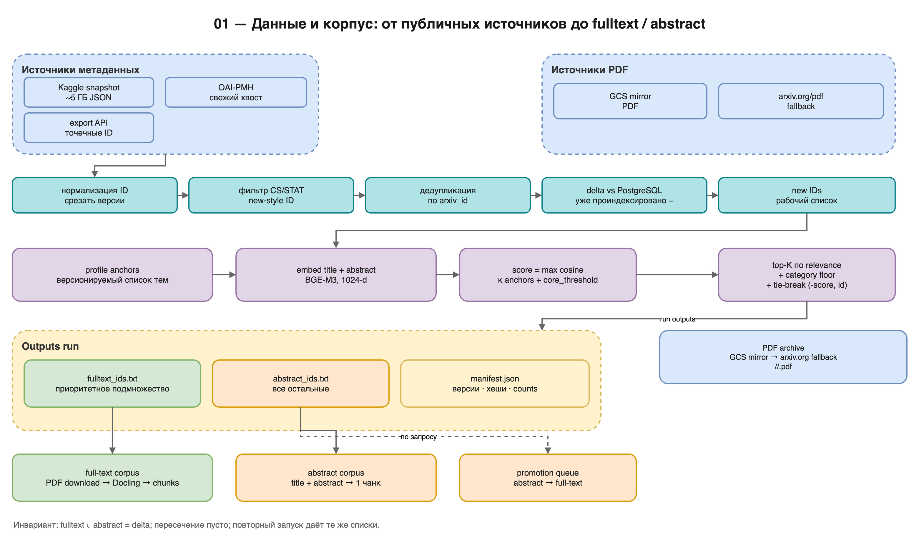

# 01 — Данные и корпус

> **Scope:** reference spec of the full deployment; this repository implements
> the core subset. See `README.md` in this directory and `../LIMITATIONS.md`.

**Цель части:** получить из публичных источников метаданные и PDF, определить
границы корпуса и решить, какие статьи индексировать полностью, а какие —
только по title+abstract.

**На выходе:**

- `metadata.json` (или JSONL) с записями arXiv;
- список ID и PDF-файлы на диске;
- два списка: `fulltext_ids.txt` и `abstract_ids.txt`;
- иммутабельный `manifest.json` с версиями, хешами и counts.

**Предпосылки:** свободное место под метаданные (единицы ГБ) и PDF
(сотни ГБ — ТБ); сеть; Python 3.10+; опционально `gsutil`, но можно обойтись
stdlib.



*Схема 01 — от публичных источников до двух списков и манифеста. Исходник:
`diagrams/01-data-and-corpus.drawio`.*

---

## 1. Источники данных arXiv

В reference-системе используются все четыре публичных канала. Они
взаимодополняющие, а не взаимоисключающие.

### 1.1. Kaggle snapshot — основной источник метаданных

- URL: `https://www.kaggle.com/datasets/Cornell-University/arxiv`
- Файл: `arxiv-metadata-oai-snapshot.json` (~5 ГБ, JSON-массив).
- Содержимое: `id`, `title`, `authors`, `abstract`, `categories`,
  `versions`, `update_date`, `journal-ref`, `doi` и др.
- Обновляется периодически (в reference-практике — примерно еженедельно,
  но с лагом до нескольких дней).
- Плюсы: полный, надёжный, один файл, без rate limit.
- Минусы: лаг; каждый раз качать ~5 ГБ; формат/поле `authors` может быть
  строкой или списком в зависимости от версии снапшота.

Ключевой вывод reference-проекта: Kaggle snapshot — базовый слой, а свежий
хвост добирается OAI-PMH. Не полагайся только на Kaggle, если нужна
свежесть «до сегодня».

Пример загрузки:

```bash
kaggle datasets download Cornell-University/arxiv \
  -f arxiv-metadata-oai-snapshot.json -p <DATA_ROOT>/metadata
unzip -o <DATA_ROOT>/metadata/arxiv-metadata-oai-snapshot.json.zip \
  -d <DATA_ROOT>/metadata
```

Если Kaggle CLI не настроен, скачай архив вручную со страницы датасета.

### 1.2. OAI-PMH — свежий хвост и инкрементальные дельты

Endpoint: `https://oaipmh.arxiv.org/oai`

Параметры, использованные в reference-системе:

```
verb=ListRecords
set=cs
metadataPrefix=arXivRaw
from=YYYY-MM-DD
until=YYYY-MM-DD
```

- Пагинация — `resumptionToken`; пустой токен означает конец.
- Вежливость: пауза **≥1,5 с** между запросами; на `429/503` — экспоненциальный
  backoff (3 → 6 → 12 → … до 60 с), несколько попыток.
- Записи со `status="deleted"` пропускаются.
- `arXivRaw` содержит `id`, `title`, `abstract`, `authors`, `categories`,
  `primary_category`, `versions`, `created`, `updated`.
- Старые ID вида `cs/0701001` можно отфильтровать, если система работает
  только с новым форматом `YYMM.NNNNN`.

Поля, которые нужно нормализовать:

- `id` — без версии (`2601.00001v2` → `2601.00001`);
- `authors` — список; в OAI-формате авторы могут быть разделены `, ` и ` and `;
- `categories` — пробел-разделённый список, первый элемент — primary;
- `abstract` — схлопнуть повторные пробелы/переводы строк.

### 1.3. arXiv export API — точечные запросы по ID

Endpoint: `https://export.arxiv.org/api/query` (Atom XML).

Возможности:

- `search_query=id:2601.00001 OR id:2601.00002 ...`;
- `id_list=...` — список ID без версий;
- `max_results` до 2000, пагинация `start`;
- `sortBy=submittedDate|lastUpdatedDate|relevance`.

Ограничения и этикет:

- официально ~**1 запрос в 3 секунды**;
- обязательный осмысленный `User-Agent`;
- на `429/503` — retry с backoff;
- версия в `atom:id` срезается (`http://arxiv.org/abs/2601.00001v3` →
  `2601.00001`).

Reference-практика: батчи по 100 ID с паузой 3 с. Это медленнее, чем один
`id_list` на тысячу, зато устойчивее к обрывам и лимитам.

Синтаксис запросов, который полезен для проверок:

```
id:2312.00001
cat:cs.CL AND submittedDate:[202601010000 TO 202601312359]
ti:"retrieval augmented" AND abs:evaluation
all:transformer OR au:"Vaswani"
```

### 1.4. PDF — публичное GCS-зеркало и fallback arXiv

Reference-источник (быстрый, без rate limit, без credentials):

```
https://storage.googleapis.com/arxiv-dataset/arxiv/arxiv/pdf/{YYMM}/{id}v{ver}.pdf
```

где `YYMM` — первые 4 символа нового ID (`2601.00001` → `2601`).

Fallback для свежих статей, которых ещё нет в зеркале:

```
https://arxiv.org/pdf/{id}v{ver}
```

Правила скачивания:

- пробовать версии `v1`, `v2`, `v3` (в reference — до `MAX_VERSION=3`);
- файл считается валидным, если размер > ~500 байт и первые 4 байта `%PDF`;
- частичные/битые загрузки удалять и повторять;
- локальный layout: `<PDF_ROOT>/<YYMM>/<id>.pdf`;
- идемпотентность: существующий валидный файл не перекачивать;
- параллельность — 6–10 потоков; при странной медленности проверь IPv6:
  в reference-среде IPv6-маршрут был битым, принудительный IPv4 дал
  ~4,9 МБ/с вместо ~0,3 МБ/с;
- обязательно вести `failed_ids.txt` и повторять их отдельно.

**LaTeX-исходники не используются.** Reference-система работает только с PDF.
Не трать время на AWS Requester Pays и LaTeX-ветку, если не готова платить
и поддерживать отдельный парсер.

---

## 2. Что считать «корпусом»

Reference-корпус:

- категории **CS и STAT** (`cs.*`, `stat.*`), преимущественно CS;
- годы **2007–2026** (new-style ID);
- только статьи, для которых есть PDF (для full-text) или метаданные
  (для abstract-only);
- старые ID (`cs/0701001`) в reference-ингест не входят; допускаются как
  metadata-only, если нужны.

Важно разделять три сущности:

1. **Метаданные** — записи arXiv (может быть ~1,07 млн CS/STAT).
2. **PDF-архив** — скачанные файлы (в reference ~596 тыс. / ~2,35 ТБ,
   в основном CS 2022+).
3. **Проиндексированный корпус** — статьи, реально попавшие в PG + Qdrant
   (в reference ~329 тыс.). Это подмножество первых двух, а не их сумма.

Не обещай «проиндексировать всё, что есть в метаданных», если PDF нет.

---

## 3. Первичная загрузка (с нуля)

### Шаг 1. Метаданные

1. Скачай Kaggle snapshot.
2. Загрузи JSON, отфильтруй CS/STAT, нормализуй поля.
3. Срежь версии, удали дубли ID.
4. Сохрани компактный JSON/JSONL только с нужными полями.

Пример фильтрации:

```python
import json
import re
from pathlib import Path

SRC = Path("<DATA_ROOT>/metadata/arxiv-metadata-oai-snapshot.json")
DST = Path("<DATA_ROOT>/metadata/cs_stat.json")
OUT = []
seen = set()
_VERSION_RE = re.compile(r"v\d+$")

rows = json.loads(SRC.read_text())
for r in rows:
    aid = _VERSION_RE.sub("", (r.get("id") or "").strip())
    if not aid or "." not in aid or "/" in aid:   # только new-style
        continue
    cats = (r.get("categories") or "").split()
    if not any(c == "cs" or c.startswith("cs.")
               or c == "stat" or c.startswith("stat.") for c in cats):
        continue
    if aid in seen:
        continue
    seen.add(aid)
    OUT.append({
        "id": aid,
        "title": " ".join((r.get("title") or "").split()),
        "abstract": " ".join((r.get("abstract") or "").split()),
        "authors": r.get("authors") or "",
        "categories": " ".join(cats),
        "update_date": (r.get("update_date") or "").strip(),
    })

DST.write_text(json.dumps(OUT, ensure_ascii=False))
print("records:", len(OUT))
```

Опционально добавь OAI-PMH за последние дни, чтобы закрыть лаг Kaggle.
Используй `--exclude-metadata`, чтобы не дублировать уже известные ID.

### Шаг 2. Список ID и PDF

```bash
# список ID — по одному на строку
python3 - <<'PY'
import json
rows = json.load(open("<DATA_ROOT>/metadata/cs_stat.json"))
with open("<DATA_ROOT>/metadata/all_ids.txt", "w") as f:
    for r in rows:
        f.write(r["id"] + "\n")
PY
```

Скачивание (схема reference; можно реализовать stdlib-скриптом):

```bash
python3 scripts/download_pdfs_https.py \
  --id-file <DATA_ROOT>/metadata/all_ids.txt \
  --pdf-dir <DATA_ROOT>/pdfs \
  --workers 8 \
  --failed-out <DATA_ROOT>/metadata/download_failed.txt
```

Если используешь `gsutil`:

```bash
gsutil -m cp -I <DATA_ROOT>/pdfs/...   # см. официальную документацию gsutil
```

`-I`-режим требует аккуратной раскладки по подкаталогам; проще скачивать по
одному файлу в `<PDF_ROOT>/<YYMM>/<id>.pdf`.

### Шаг 3. Проверка

```bash
# сколько ID и сколько PDF
wc -l <DATA_ROOT>/metadata/all_ids.txt
find <DATA_ROOT>/pdfs -name '*.pdf' | wc -l
find <DATA_ROOT>/pdfs -name '*.pdf' -size -500c | wc -l   # должно быть 0
```

Ожидается: PDF не больше числа ID (часть статей может отсутствовать в
зеркале), битых файлов — 0 после ретраев.

---

## 4. Инкрементальное обновление корпуса

Цель — добавить новые статьи, не переиндексируя старые и не теряя IDs.

### 4.1. Сбор дельты

1. Скачай свежий Kaggle snapshot (vN) и сравни ID с предыдущим (vN-1):
   `delta_kaggle = new_ids`.
2. Добери OAI-PMH за дни после даты снапшота:
   `delta_oai = oai_ids`.
3. Объедини: `delta = delta_kaggle ∪ delta_oai`.
4. **Вычти то, что уже есть в PG** (`SELECT arxiv_id FROM papers`).
   Это критично: часть «новых» ID могла быть добавлена expansion-ом или
   другой рутиной.
5. Для каждого ID проверь наличие PDF; отсутствующие поставь в очередь
   скачивания.
6. Повтори сбор после скачивания: рабочий список = `delta ∩ PDF − indexed`.

Reference-урок: «новые» по метаданным ≠ новые для системы. Кросс-чек с PG
обязателен. В одном прогоне из 26 811 «новых» 2 838 уже были в базе.

### 4.2. Идемпотентность

- `ingestion_progress` в PG — единственный источник истины о том, что уже
  проиндексировано; не полагайся на список файлов.
- Повторный запуск должен пропускать `stage='indexed' AND status='done'`.
- Abstract-only статьи имеют `stage='abstract_indexed'`; full-text пайплайн
  не должен считать их «готовыми» для full-text.
- Если процесс упал в середине, `status='in_progress'` можно сбросить и
  переобработать: запись в PG и Qdrant идемпотентна по `chunk_id`/hash.
- Очень старые `failed` могут быть «мусором прошлых эпох». Перед retry
  проверь дату/причину и не поднимай их все слепо: они могут съесть
  throughput на таймаутах.

### 4.3. Ресурсная оценка дельты

Считай заранее:

- PDF: `n_fulltext × средний размер PDF` (в reference ~3–4 МБ/статья);
- чанки: `n_fulltext × 60–80` (зависит от PDF и парсера);
- PG+Qdrant: ~6–7 КБ на чанк (dense 1024-d INT8 + sparse + payload);
- abstract-only: ~1 чанк и ~7 КБ на статью;
- время: `n_fulltext / 1,5–1,9 статей/с` на reference-железе.

Если не влезает — уменьшай **глубину** (abstract tier), а не discovery:
abstract-only слой дешёвый и сохраняет находимость.

---

## 5. Политика отбора `abstract_tier` v1

### 5.1. Зачем

Full-text на каждую новую статью растёт линейно и быстро упирается в диск:

- ~25–30 тыс. статей/мес → ~100 ГБ PDF и ~12 ГБ БД в месяц;
- полный full-text батч 27,5 тыс. статей — ~107 ГБ PDF, ~1,9 млн чанков,
  ~13,5 ГБ БД, ~5 ч GPU.

Reference-решение: discovery не режем, глубину режем.

### 5.2. Уровни

| Tier | Что индексируется | Стоимость | Когда |
|---|---|---|---|
| **A — abstract** | title + abstract, 1 чанк | ~0,2 ГБ на 27,5 тыс. | все новые статьи |
| **B — fulltext** | PDF → Docling → чанки | ~25–31 ГБ PDF + ~4 ГБ БД на 7–8 тыс. | приоритетное подмножество |
| **C — promotion** | дозагрузка full-text по запросу | по требованию | abstract-статья стала нужна |

Инвариант: `abstract_ids = delta − fulltext_ids`; каждая статья попадает
ровно в один tier.

### 5.3. Алгоритм v1: `relevance_plus_category_floor`

1. Для каждой статьи считается `title + "\n\n" + abstract`.
2. Считается косинус к каждому anchor-запросу профиля; score = **max**.
3. Берутся top-K по score (`top_k_by_relevance`, reference 7000).
4. Добавляется **floor**: не менее `category_floor` (reference 25) статей
   из каждой primary-категории, лучших по score.
5. Детерминированный tie-break: `(-score, arxiv_id)`.
6. Результат: `fulltext_ids`, `abstract_ids`, `scores.jsonl`.

Профиль — это версионируемый набор тематических anchor-запросов. Пример
(сокращённо; полный профиль — в конфиге):

```json
{
  "profile_id": "course_content_manager_2026_10",
  "profile_version": 1,
  "score": "max_cosine",
  "core_threshold": 0.55,
  "anchors": [
    {"topic": "repro_ml", "query": "reproducible machine learning benchmark"},
    {"topic": "repro_ml", "query": "open source experiment code"},
    {"topic": "slm_agents", "query": "small language model agent"},
    {"topic": "agent_security", "query": "prompt injection LLM agent"},
    {"topic": "agentic_memory", "query": "long-term memory LLM agent"},
    {"topic": "llm_reliability", "query": "semantic entropy probes hallucination"},
    {"topic": "agent_consensus", "query": "multi-agent consensus debate"}
  ]
}
```

Полный конфиг v1 содержит 26 anchors по темам: reproducible ML, small language
model agents, autonomous scientific discovery, agent security, agentic memory,
LLM reliability, agent consensus.

### 5.4. Конфиг политики

```json
{
  "schema_version": 1,
  "policy_id": "abstract_tier",
  "policy_version": 1,
  "status": "active",
  "profile": {"profile_id": "...", "profile_version": 1,
               "score": "max_cosine", "core_threshold": 0.55,
               "anchors": [{"topic": "...", "query": "..."}]},
  "tiers": {
    "abstract": {
      "enabled": true,
      "text_template": "{title}\n\n{abstract}",
      "heading_path": "Abstract",
      "chunk_index": 0,
      "tier_payload": "abstract",
      "write_payload_text": false,
      "ingestion_stage": "abstract_indexed",
      "embedding_model": "BAAI/bge-m3"
    },
    "fulltext": {"enabled": true, "pdf_policy": "fulltext_only",
                  "selection": "relevance_plus_category_floor"}
  },
  "selection": {
    "algorithm": "select_ingest_tier",
    "algorithm_version": 1,
    "top_k_by_relevance": 7000,
    "category_floor": 25,
    "category_field": "primary_category",
    "tie_breaker": "arxiv_id_asc",
    "deterministic": true
  },
  "promotion": {
    "enabled": true, "mode": "explicit", "queue_table": "promotion_queue",
    "worker_location": "gpu", "max_attempts": 3, "timeout_s": 1800,
    "pdf_download": "gcs_then_arxiv", "replace_abstract_chunk": true
  }
}
```

**Правило версионирования:**

- `policy_version` — правила (top-k, floor, tier-структура);
- `profile_version` — набор anchors;
- `algorithm_version` — код селектора;
- `run_id` — конкретный прогон.

Конфиг после запуска **иммутабелен**: изменения → новый файл и новая версия.
Старые run-директории не перезаписываются.

### 5.5. Артефакты прогона

```
<DATA_ROOT>/corpus_policy/runs/<run_id>/
  fulltext_ids.txt
  abstract_ids.txt
  scores.jsonl
  anchors.json
  anchor_embeddings.npy
  manifest.json
```

`manifest.json` обязан содержать:

- policy/profile/algorithm id + version;
- sha256 конфига, скрипта селектора, входных метаданных;
- counts: total / fulltext / abstract / categories / core coverage;
- category distribution;
- параметры top-k/floor/tie-break;
- sha256 выходных списков;
- версию модели эмбеддингов и источник векторов;
- дату и время.

Проверки:

- `fulltext ∪ abstract = all`, пересечение пусто;
- floor соблюдён для каждой primary-категории;
- повторный запуск с теми же входами даёт побайтово те же списки;
- `core_threshold` (reference 0.55) покрыт на 100% (в reference — 2 855/2 855).

### 5.6. Reference-результат прогона 2610 (2026-10-17)

| Параметр | Значение |
|---|---|
| входа | 27 520 записей |
| fulltext | **7 945** |
| abstract-only | **19 575** |
| категорий | 125 |
| floor violations | 0 |
| core ≥ 0,55 | 2 855 / 2 855 (100%) |

После ингеста: 7 946 full-text (7 945 + 1 promoted), 19 574 abstract-чанка,
0 missing, PG↔Qdrant дельты совпали до точки.

### 5.7. Как выпустить новую версию

1. Скопируй конфиг в `v2_<change>.json`.
2. Подними `policy_version` (правила) или `profile_version` (anchors).
3. Прогони селектор в новую `run_id`-директорию.
4. Сравни manifest'ы: counts, распределение по категориям, core coverage,
   floor violations, sha256.
5. Задокументируй изменение и причину.

---

## 6. Контракты данных и качество

### 6.1. Обязательные поля статьи

| Поле | Тип | Правило |
|---|---|---|
| `id` | str | без версии; new-style `YYMM.NNNNN` |
| `title` | str | схлопнутые пробелы |
| `abstract` | str | схлопнутые пробелы |
| `authors` | list[str] | разбить по `, ` и ` and `; убрать пустые |
| `categories` | list[str] | первый — primary |
| `update_date` | str | ISO-дата, если есть |

### 6.2. Дедупликация

- ID дедуплицируются до ингеста; дубли считаются и логируются.
- Текст чанка дедуплицируется по `sha256(text)` в PG (`UNIQUE`).
  Если тот же текст встретился в другой статье, чанк не дублируется;
  опционально пишется alias `(chunk_id, arxiv_id, chunk_index)`.
- Одинаковый текст в одной статье (колонтитулы, повторы) не должен
  превращаться в несколько точек Qdrant: reference пишет только первое
  вхождение хеша на статью.

### 6.3. Нормализация текста

- Удаляй `\x00` и C0/C1 control characters (кроме `\n`, `\t`, `\r`):
  PostgreSQL TEXT не принимает `\x00`, а строгие JSON-клиенты — C1.
- Не «улучшай» формулы и LaTeX-подобные вставки: парсер уже отдал текст.
- Пустые/подозрительно короткие статьи (<100 символов markdown) помечай
  `suspiciously_short_md` и не считай успешным парсингом без проверки.

### 6.4. Лицензии и этикет

- arXiv metadata и PDF — публичные, но соблюдай лимиты и `User-Agent`.
- Не перепубликуй PDF/дампы корпуса.
- Для массовых скачиваний используй зеркало GCS, а не `arxiv.org/pdf`
  построчно; `arxiv.org` — fallback для свежих статей.
- OAI-PMH — пауза ≥1,5 с; export API — ~1 запрос / 3 с.

---

## 7. Планирование объёмов

| Сущность | На 1 тыс. статей | На 100 тыс. | На 330 тыс. |
|---|---|---|---|
| Метаданные (JSON) | ~5 МБ | ~0,5 ГБ | ~1,5–2 ГБ |
| PDF (full-text) | ~3–4 ГБ | ~300–400 ГБ | ~2,3–2,5 ТБ |
| Чанки (60–80/статья) | 60–80 тыс. | 6–8 млн | 20–26 млн |
| PG + Qdrant (dense+sparse) | ~0,4–0,5 ГБ | ~40–50 ГБ | ~150–180 ГБ |
| Время ингеста (reference) | ~10–15 мин | ~15–20 ч | ~2–3 суток |

Числа — ориентиры, не гарантии: PDF, парсер, диск и сеть меняют результат
в разы. Считай **до** запуска и оставляй запас 20–30%.

---

## 8. Типичные ошибки

| Ошибка | Симптом | Лечение |
|---|---|---|
| Не срезана версия ID | дубли `2601.00001` и `2601.00001v2` | нормализовать ID при загрузке |
| Дубли ID не удалены | `papers` падает на PK / counts врут | дедуп + assert |
| OAI без паузы | 503/429, обрывы | ≥1,5 с, backoff, resumable |
| IPv6 без маршрута | PDF качается на 0,3 МБ/с, 40% miss | принудительный IPv4 |
| Битый PDF считается успехом | пустые чанки | проверка `%PDF` + размер |
| «Новые» ID не сверены с PG | повторный ингест, дубли | `delta − indexed` |
| Полный full-text без расчёта диска | диск кончается в середине | abstract tier / меньше K |
| Недетерминированный tie-break | разные списки при повторном запуске | `(-score, arxiv_id)` |
| Конфиг меняется после запуска | manifest не воспроизводится | новый файл + версия |
| Профиль anchors не версионирован | непонятно, почему изменился отбор | `profile_version` |

---

## 9. Что дальше

Списки `fulltext_ids.txt` и `abstract_ids.txt` — вход для
[02 — ингест и индексы](02-ingestion-and-indexing.md). Не начинай ингест,
пока не пройдены проверки §5.5 и не зафиксирован manifest.
