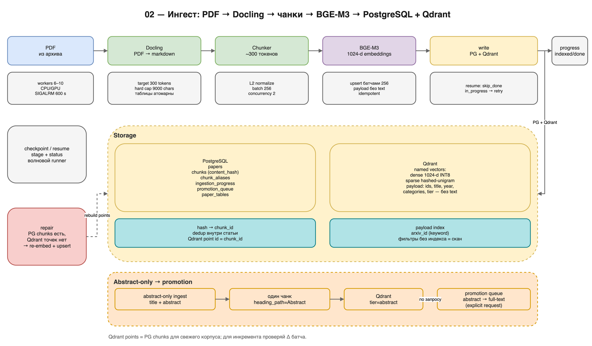

# 02 — Ингест и индексация

> **Scope:** reference spec of the full deployment; this repository implements
> the core subset. See `README.md` in this directory and `../LIMITATIONS.md`.

**Цель части:** превратить PDF (full-text) или `title + abstract`
(abstract-only) в записи PostgreSQL и точки Qdrant, устойчиво к обрывам и
повторным запускам.

**На выходе:**

- `papers`, `chunks`, `ingestion_progress` заполнены;
- Qdrant-коллекция с named vectors `dense` + `sparse`;
- число точек Qdrant = число чанков PG;
- abstract-only статьи имеют ровно один чанк;
- `promotion_queue` и worker для дозагрузки full-text.

**Предпосылки:** выполнена [01](01-data-and-corpus.md); есть PDF и списки
ID; запущены PostgreSQL и Qdrant; доступен OpenAI-compatible endpoint
эмбеддингов BGE-M3.



*Схема 02 — стадии пайплайна, хранилища и две ветки: abstract-only и
promotion. Исходник: `diagrams/02-ingestion.drawio`.*

---

## 1. Общая схема пайплайна

Одна статья обрабатывается последовательно:

```
upsert paper
   ↓
parse PDF (Docling → markdown)
   ↓
chunk markdown (~300 токенов)
   ↓
embed batches (BGE-M3, 1024-d)
   ↓
write PG chunks + Qdrant points (dense + sparse)
   ↓
ingestion_progress: indexed/done
```

Параллелизм:

- пул Docling-воркеров (parse);
- до `in_flight` статей одновременно;
- эмбеддинги — HTTP-батчи с ограничением конкурентности;
- запись PG/Qdrant — асинхронные батчи.

Reference-реализация использует `asyncio.Semaphore(in_flight)` и нарезку
списка статей на пачки (bounded memory). Producer/consumer с
`asyncio.Queue` в reference-среде приводил к зависанию под fork-based
Docling; семантический аналог — «нарезать список на батчи и запускать
задачи с семафором» — работает устойчиво.

**Ключевое правило:** таймаут статьи должен покрывать и ожидание в очереди
парсера. Если `in_flight` сильно больше числа воркеров, короткий таймаут
будет срабатывать на статьях, которые ещё не начинали парситься. Рабочая
точка reference: `in_flight ≈ 2–3 × parser_workers`; в прогонах —
40 in-flight при 10–12 воркерах, `PAPER_TIMEOUT_S=1800`.

### 1.1. Минимальные зависимости

Python-пакеты (версии зафиксируй у себя):

```
fastapi
uvicorn
pydantic
httpx
asyncpg
qdrant-client
numpy
tiktoken
PyYAML
docling              # PDF → markdown
torch                # только для in-process reranker
transformers         # только для in-process reranker
```

Отдельные сервисы (не pip):

- **BGE-M3** — vLLM (GPU) или llama.cpp (CPU/ARM), OpenAI-compatible
  `/v1/embeddings`;
- **LLM** — vLLM или llama.cpp, `/v1/chat/completions`;
- **reranker** — либо `torch`+`transformers` в процессе API, либо
  llama.cpp `--reranking` по HTTP.

Если не нужен in-process reranker, `torch`/`transformers` не обязательны:
используй HTTP-режим.

---

## 2. Схема PostgreSQL

Минимальный набор таблиц:

```sql
CREATE TABLE IF NOT EXISTS papers (
    arxiv_id     TEXT PRIMARY KEY,
    title        TEXT,
    authors      TEXT[],
    categories   TEXT[],
    abstract     TEXT,
    submit_date  DATE,
    journal_ref  TEXT,
    pdf_path     TEXT,              -- NULL для abstract-only
    parsed_at    TIMESTAMPTZ
);

CREATE TABLE IF NOT EXISTS chunks (
    chunk_id            UUID PRIMARY KEY DEFAULT gen_random_uuid(),
    content_hash_sha256 TEXT NOT NULL,
    text                TEXT NOT NULL,
    arxiv_id            TEXT NOT NULL REFERENCES papers(arxiv_id) ON DELETE CASCADE,
    heading_path        TEXT,
    chunk_index         INTEGER NOT NULL,
    token_count         INTEGER NOT NULL,
    embedding_model     TEXT,
    created_at          TIMESTAMPTZ NOT NULL DEFAULT NOW(),
    UNIQUE (content_hash_sha256)
);

CREATE INDEX IF NOT EXISTS chunks_arxiv_id_idx
    ON chunks(arxiv_id);
CREATE INDEX IF NOT EXISTS chunks_arxiv_id_chunk_idx
    ON chunks(arxiv_id, chunk_index);

-- опционально: cross-document dedup
CREATE TABLE IF NOT EXISTS chunk_aliases (
    chunk_id    UUID NOT NULL REFERENCES chunks(chunk_id) ON DELETE CASCADE,
    arxiv_id    TEXT NOT NULL,
    chunk_index INTEGER NOT NULL,
    PRIMARY KEY (chunk_id, arxiv_id, chunk_index)
);

CREATE TABLE IF NOT EXISTS ingestion_progress (
    arxiv_id   TEXT PRIMARY KEY,
    stage      TEXT NOT NULL,   -- queued|parsed|chunked|embedded|indexed|abstract_indexed
    status     TEXT NOT NULL,   -- in_progress|done|failed
    updated_at TIMESTAMPTZ NOT NULL DEFAULT NOW(),
    error      TEXT
);

CREATE INDEX IF NOT EXISTS ingestion_progress_status_idx
    ON ingestion_progress(status, stage);

CREATE TABLE IF NOT EXISTS promotion_queue (
    arxiv_id     TEXT PRIMARY KEY REFERENCES papers(arxiv_id) ON DELETE CASCADE,
    status       TEXT NOT NULL DEFAULT 'queued',  -- queued|running|done|failed
    attempts     INTEGER NOT NULL DEFAULT 0,
    requested_at TIMESTAMPTZ NOT NULL DEFAULT NOW(),
    started_at   TIMESTAMPTZ,
    finished_at  TIMESTAMPTZ,
    error        TEXT,
    requested_by TEXT
);

CREATE INDEX IF NOT EXISTS promotion_queue_status_idx
    ON promotion_queue(status, requested_at);

CREATE TABLE IF NOT EXISTS paper_tables (
    arxiv_id    TEXT NOT NULL REFERENCES papers(arxiv_id) ON DELETE CASCADE,
    table_index INTEGER NOT NULL,
    page        INTEGER,
    markdown    TEXT NOT NULL DEFAULT '',
    rows_json   JSONB NOT NULL DEFAULT '[]'::jsonb,
    metrics     JSONB NOT NULL DEFAULT '{}'::jsonb,
    parsed_at   TIMESTAMPTZ NOT NULL DEFAULT NOW(),
    PRIMARY KEY (arxiv_id, table_index)
);
```

Замечания:

- `UNIQUE(content_hash_sha256)` — дедупликация одинакового текста.
  При конфликте чанк не вставляется; при необходимости пишется alias.
- `chunk_index` — 0-based, документ-последовательный.
- `token_count` — число токенов чанка.
- `embedding_model` — идентификатор модели (для аудита переиндексации).
- `papers.submit_date` может быть NULL; год в payload вычисляется из
  `arxiv_id` (`YYMM` → 20YY).
- `tier` отдельной колонкой не хранится: abstract-only определяется как
  «у статьи ровно один чанк с `heading_path='Abstract'`».

---

## 3. Коллекция Qdrant

Одна коллекция, два named vector'а:

```python
from qdrant_client import QdrantClient
from qdrant_client.http.models import (
    Distance, VectorParams, SparseVectorParams,
    ScalarQuantization, ScalarQuantizationConfig, ScalarType,
    HnswConfigDiff, OptimizersConfigDiff,
)

client = QdrantClient(url="<QDRANT_URL>", timeout=120)
client.create_collection(
    collection_name="<COLLECTION>",
    vectors_config={
        "dense": VectorParams(size=1024, distance=Distance.COSINE, on_disk=True),
    },
    sparse_vectors_config={"sparse": SparseVectorParams()},
    quantization_config=ScalarQuantization(
        scalar=ScalarQuantizationConfig(
            type=ScalarType.INT8, quantile=0.99, always_ram=True,
        )
    ),
    hnsw_config=HnswConfigDiff(on_disk=True),
    optimizers_config=OptimizersConfigDiff(indexing_threshold=50000),
)
```

Почему так:

- `on_disk=True` у dense — оригиналы fp32 на диске; INT8 — в RAM;
- `rescore=True` при поиске пересчитывает top-K по fp32 и компенсирует
  потери INT8;
- HNSW на диске — экономия RAM на больших корпусах;
- `indexing_threshold=50000` — HNSW строится после 50k точек; для маленьких
  L1-корпусов можно снизить, чтобы не ждать;
- sparse-вектор не квантуется.

**Payload-индексы обязательны для фильтров.** Без индекса фильтр по
`arxiv_id` — это скан всех точек; на 20 млн точек и ограниченной RAM это
гарантированный таймаут.

```bash
curl -X PUT "<QDRANT_URL>/collections/<COLLECTION>/index" \
  -H 'Content-Type: application/json' \
  -d '{"field_name":"arxiv_id","field_schema":"keyword"}'
```

При необходимости добавь `year` (integer) и `categories` (keyword).
Индексация — на спокойной системе; на ARM-плате она может идти минуты.

### 3.1. Payload точки

Обязательные поля:

```json
{
  "arxiv_id": "2601.00001",
  "chunk_id": "<uuid>",
  "chunk_index": 3,
  "heading_path": "3. Method > 3.2 Training",
  "token_count": 287,
  "content_hash_sha256": "...",
  "title": "...",
  "year": 2026,
  "categories": ["cs.CL", "cs.LG"],
  "tier": "fulltext"
}
```

**Текст в payload не пишется.** `chunks.text` в PostgreSQL — единственный
источник истины; API гидратирует текст одним батч-запросом по `chunk_id`.
Это экономит примерно половину RAM/диска Qdrant. Если пропустить этот шаг,
система работает, но потребляет заметно больше памяти.

`tier` для full-text можно не писать (по умолчанию `"fulltext"`), но лучше
писать явно. Для abstract-only — `"abstract"`.

---

## 4. Парсинг PDF (Docling)

Reference-парсер — Docling, выход — markdown. Один `DocumentConverter` на
воркер-процесс, переиспользуется между PDF.

### 4.1. Настройки

| Переменная | Reference | Смысл |
|---|---|---|
| `DOCLING_DEVICE` | `cpu` при co-location с vLLM; `cuda` на выделенном batch-GPU | устройство парсинга |
| `DOCLING_DO_OCR` | `false` | arXiv PDF — born-digital; OCR не нужен, экономит время |
| `DOCLING_DO_TABLE_STRUCTURE` | `false` на больших прогонах | +~28% throughput при почти том же структурном выходе; таблицы всё равно извлекаются markdown-ом |
| `DOCLING_NUM_THREADS` | `4` | CPU thread hint |
| `HF_HUB_OFFLINE` | `1` при проблемах с сетью | Docling не проверяет ревизию модели по сети |
| `TRANSFORMERS_OFFLINE` | `1` | то же |

Трейд-офф GPU/CPU:

- На **общем** GPU Docling-воркеры конкурируют с vLLM-эмбеддером.
  В reference-замере 4 GPU-воркера дали aggregate-скорость в ~5 раз ниже,
  чем 1: contention перевешивает параллелизм. Для co-location используй
  `DOCLING_DEVICE=cpu`.
- На **выделенном** batch-хосте `cuda` + 6–10 воркеров + отключённый table
  structure даёт 1,5–1,9 статьи/с.
- Всегда замеряй на своих PDF: скорость зависит от года, формул, таблиц.

### 4.2. Обязательные защиты

1. **Hard timeout на воркер.** Docling может зависнуть на сложном PDF или
   GPU-contention. Reference ставит `SIGALRM` на 600 с внутри воркера и
   возвращает ошибку — иначе зависший воркер навсегда занимает слот пула.
2. **Таймаут на уровне статьи** (`PAPER_TIMEOUT_S`, reference 1800 с при
   больших очередях) с пометкой `failed`.
3. **Recycling воркеров** (`maxtasksperchild`, reference 200). Docling
   накапливает память (~единицы–десятки МБ на PDF); без recycling RSS растёт
   линейно и приводит к OOM. После N PDF воркер пересоздаётся.
4. **Изоляция ошибок.** Плохой PDF → `ok=False`, пул не падает.
5. **Подозрительно короткий markdown** (`<100` символов) — soft-failure:
   логировать и не считать полноценным парсингом.
6. **Offline-HF** при битом IPv6/сети: иначе Docling может зависнуть на
   проверке ревизии модели.

### 4.3. Контракт результата парсинга

```python
@dataclass
class ParseResult:
    arxiv_id: str
    pdf_path: str
    markdown: str | None
    ok: bool
    error: str | None
    latency_s: float
    pdf_bytes: int
    markdown_chars: int
```

Промежуточный markdown на диск **не сохраняется** (только чанки в PG), если
нет отдельной причины для отладки.

---

## 5. Чанкинг markdown

Reference-правила:

1. ATX-заголовки (`# ... ######`) задают секции. Текущая цепочка заголовков
   образует `heading_path` (`Methods > 3.2 Training`).
2. Текст группируется по абзацам до `target_tokens ≈ 300`.
3. Абзац не режется посередине; если один абзац больше target — он всё
   равно становится отдельным чанком (после hard cap).
4. Таблицы (markdown pipe-таблицы) — **атомарные** чанки с префиксом
   `[TABLE]\n`. Одна таблица = один чанк (STC, small table chunk).
5. **Hard cap 9000 символов** на чанк. Всё, что больше, режется до
   группировки: таблицы — по строкам с повтором заголовка, текст — по
   границам предложений, отдельное гигантское предложение — по окну.
6. Overlap **не используется** (reference-эксперимент показал регресс
   nDCG/recall).
7. `chunk_index` — сквозной 0-based по документу.
8. `content_hash_sha256 = sha256(text)`.
9. `token_count` — tiktoken `cl100k_base`, fallback `words × 1.3`.
10. Control-символы (`\x00`, C0 кроме `\n\t\r`, DEL, C1) заменяются
    пробелом до записи в PG/Qdrant.

Зачем hard cap: эмбеддер BGE-M3 имеет контекст 8192 токена (XLM-R), а
Docling иногда выдаёт таблицы на десятки тысяч символов. Без cap такие
чанки отклоняются или молча обрезаются.

Reference-статистика: ~60–80 чанков на full-text статью (зависит от PDF).

---

## 6. Эмбеддинги (BGE-M3)

### 6.1. Контракт

- Модель: `BAAI/bge-m3`, dense 1024-d.
- Endpoint: OpenAI-compatible `POST /v1/embeddings`
  (`<EMBED_URL>`, обычно `http://<host>:<port>/v1/embeddings`).
- `model` — id, который принимает сервер. В vLLM это может быть полный путь
  к локальным весам; короткое имя может дать 404. Проверь `/v1/models`.
- Тело: `{"model": "...", "input": ["...", ...], "encoding_format": "float"}`.
- Ответ сортируется по `index` (сервер может переставить элементы).
- **Клиент нормализует вектор по L2.** Qdrant `COSINE` — вторая страховка.
- Zero-norm (`||v|| < 1e-12`) → чанк пропускается с логом (мусорный парс).
- Батч — 256 чанков; конкурентность — 2 (reference-оптимум для vLLM).
- Таймаут — с запасом; на медленном CPU-сервере 600 с, иначе батч
  гарантированно «падает» на больших статьях.
- Retry: 3 попытки с backoff 1/2/5 с; затем одно деление батча пополам
  (минимум 64) и ещё 2 попытки; затем `EmbedError`.
- Defensive cap: текст >100k символов обрезается с логом (защита батча от
  одного патологического чанка).

### 6.2. Конфигурация endpoint'а

**Не читай endpoint на этапе импорта модуля.** Это классическая ошибка:
переменная окружения выставляется позже, чем модуль импортирован, и все
запросы уходят на старый дефолт. Резолви endpoint в конструкторе:

```
explicit argument > environment variable > fallback
```

И логируй `embedder_endpoint_set` при старте прогона.

### 6.3. Производительность

Reference-замеры:

- BGE-M3 на GPU (vLLM): **~495 чанков/с**;
- 27,5 тыс. abstract-статей: ~69 с эмбеддинга;
- на ARM-плате тот же GGUF: **~0,2 чанка/с** — для ингеста непригодно.

Если эмбеддинг медленнее парсинга — ингест упрётся в него. Считай баланс
стадий до запуска.

---

## 7. Sparse-энкодер

Reference-схема (native sparse Qdrant, не BM25-движок):

```python
import hashlib, math, re
from collections import defaultdict

SPARSE_VOCAB_SIZE = 2 ** 18  # 262144
_TOKEN_RE = re.compile(r"[A-Za-z][A-Za-z0-9'+-]*")
_STOPWORDS = frozenset({
    "the","a","an","of","in","to","and","for","is","are","was","were","be",
    "been","being","by","on","with","as","at","from","this","that","these",
    "those","it","its","we","our","i","you","your","they","their","he","she",
    "his","her","or","if","but","not","no","yes","than","then","so","such",
    "also","into",
})

def encode_sparse(text: str):
    tokens = [t for t in _TOKEN_RE.findall(text.lower())
              if t not in _STOPWORDS and len(t) > 1]
    if not tokens:
        return [], []
    counts = defaultdict(float)
    for tok in tokens:
        h = hashlib.md5(tok.encode()).digest()
        idx = int.from_bytes(h[:4], "little") % SPARSE_VOCAB_SIZE
        counts[idx] += 1.0
    indices = sorted(counts)
    values = [1.0 + math.log(counts[i]) for i in indices]  # log(1+TF)
    return indices, values
```

Критично: **query-time и index-time должны использовать один и тот же
энкодер**. Любое изменение regex/stopwords/хэша = переиндексация sparse.

Reference-замер: hashed-unigram sparse дал nDCG ~0,700 против ~0,343 у
OpenSearch BM25 на 5k-подмножестве. Поэтому OpenSearch выведен из
production (2-store).

---

## 8. Запись в PG и Qdrant

Порядок для одной статьи:

1. `upsert papers` (нужен FK для чанков).
2. `insert chunks` с `ON CONFLICT (content_hash_sha256) DO NOTHING`.
3. Прочитать чанки статьи из PG и построить `hash → chunk_id`.
4. Для каждого чанка с вектором:
   - если хеш уже встречался в этой статье — пропустить точку (dedup);
   - dense = нормализованный вектор;
   - sparse = `encode_sparse(text)`;
   - payload — без `text`;
   - добавить в батч.
5. Upsert в Qdrant **батчами по 256 точек** (pathological-статья с 2000+
   чанками не должна падать одним запросом).
6. `mark_stage(indexed, done)`.

Почему PG раньше Qdrant: PG — источник истины и checkpoint. Но если Qdrant
упал после записи PG, статья формально «в PG есть», а в Qdrant — ноль точек.
Это надо **обнаруживать и лечить**, а не игнорировать.

### 8.1. Repair

Скрипт repair:

1. читает чанки статьи из PG;
2. заново считает эмбеддинги (или берёт сохранённые);
3. пишет dense+sparse в Qdrant батчами;
4. проверяет, что число точек = числу чанков;
5. помечает `indexed/done`.

Reference-инцидент: статья с 2092 чанками записала PG, но Qdrant-upsert
упал на одном большом запросе. Repair восстановил 2092 точки за 11 с.

### 8.2. Идемпотентность

- `papers` — upsert по PK.
- `chunks` — `ON CONFLICT (content_hash) DO NOTHING`.
- Qdrant — upsert по `chunk_id` (один и тот же UUID).
- `ingestion_progress` — upsert по `arxiv_id`.
- Повторный запуск не должен создавать дубли; проверяй это на smoke.

---

## 9. Checkpoint, resume, волновой прогон

`ingestion_progress`:

| stage | status | Значение |
|---|---|---|
| `queued` | `in_progress` | в очереди |
| `parsed` | `in_progress`/`failed` | PDF распарсен |
| `chunked` | `in_progress`/`failed` | чанки построены |
| `embedded` | `in_progress`/`failed` | эмбеддинги готовы |
| `indexed` | `in_progress`/`done` | записано в PG+Qdrant |
| `abstract_indexed` | `done` | abstract-only, ждёт promotion |

Resume:

- на старте получить `done_ids = {stage='indexed' AND status='done'}`;
- вычесть из рабочего списка;
- `in_progress` после падения переобрабатывается с нуля (идемпотентно);
- опционально `reset_in_progress()` для чистоты.

Волновой прогон (для длинных обновлений):

```
rebuild worklist = delta ∩ PDF − indexed
run pipeline(worklist)
repeat until worklist empty
```

Это переживает падение процесса и не требует держать весь список в памяти.
Логируй по каждой волне: `done`, `failed`, `remaining`, `rate`, ETA,
средние `parse/embed/write`.

Сигналы:

- первый SIGINT/SIGTERM — перестать брать новые статьи, дождаться
  in-flight (с жёстким таймаутом);
- второй — жёсткая отмена;
- после рестарта — тот же resume-фильтр.

---

## 10. Abstract-only ингест

Для каждой статьи из `abstract_ids.txt`:

1. `upsert papers` (`pdf_path = NULL`).
2. Текст: `title + "\n\n" + abstract`.
3. Один чанк:
   - `heading_path = "Abstract"`,
   - `chunk_index = 0`,
   - `token_count` по обычному токенизатору,
   - `content_hash_sha256 = sha256(text)`.
4. Эмбеддинг dense + sparse — те же, что в проде.
5. Qdrant payload: `tier="abstract"`, без `text`.
6. `ingestion_progress: stage='abstract_indexed', status='done'`.

**Не используй `stage='indexed'` для abstract-only.** Иначе full-text
пайплайн решит, что статья уже сделана, и promotion не сработает.

Инвариант: abstract-ингест не трогает статьи, у которых уже есть
full-text чанки.

---

## 11. Promotion (abstract → full-text)

### 11.1. Очередь

`promotion_queue` (см. §2). API:

- `POST /promote/{arxiv_id}` — поставить в очередь; идемпотентно;
  `202`/`200` с `queued`;
- `GET /promote/{arxiv_id}` — статус.

Правила идемпотентности:

- `queued`/`running`/`done` не перезаписываются;
- `failed` можно переставить, сбросив `attempts`;
- `max_attempts` (reference 3), `timeout_s` (reference 1800).

### 11.2. Worker

Один worker на batch-хосте:

1. атомарно забирает задачу
   (`SELECT ... FOR UPDATE SKIP LOCKED`);
2. качает PDF (GCS → arxiv.org fallback);
3. запускает обычный full-text пайплайн;
4. **удаляет synthetic abstract-чанк** из PG и его точку из Qdrant;
5. пишет `done`/`failed` с ошибкой;
6. повторный promote идемпотентен.

Промоушен — **явное действие**, не скрытый автомат. Это делает поведение
предсказуемым и не раздувает корпус неожиданно.

### 11.3. Проверка e2e

На abstract-only статье:

- `GET /paper/{id}` → `tier="abstract"`, `can_promote=true`;
- `POST /promote/{id}` → queued;
- worker → PDF скачан, чанки full-text, abstract-чанк удалён;
- `GET /paper/{id}` → `tier="fulltext"`, `n_chunks > 1`;
- Qdrant: точки full-text есть, abstract-точки нет;
- повторный `POST /promote/{id}` → `already_fulltext`/идемпотентно.

---

## 12. Конфиг прогона (шаблон)

```yaml
subsample_path: <DATA_ROOT>/corpus_policy/runs/<run_id>/fulltext_ids.txt
pdf_root: <DATA_ROOT>/pdfs
metadata_path: <DATA_ROOT>/corpus_policy/runs/<run_id>/fulltext_metadata.json

pipeline:
  parser:
    workers: 8
    env:
      DOCLING_DEVICE: cuda          # или cpu при co-location
      DOCLING_DO_OCR: "false"
      DOCLING_DO_TABLE_STRUCTURE: "false"
      DOCLING_NUM_THREADS: "4"
      HF_HUB_OFFLINE: "1"
      TRANSFORMERS_OFFLINE: "1"
  chunker:
    target_tokens: 300
  embedder:
    endpoint: <EMBED_URL>
    model_id: <EMBED_MODEL_ID>
    concurrency: 2
    batch_size: 256
  in_flight: 40
  progress_every: 200

storage:
  postgres_dsn: <PG_DSN>
  qdrant_url: <QDRANT_URL>
  qdrant_collection: <COLLECTION>
  enable_opensearch: false
  write_native_sparse: true
  recreate_qdrant: false          # НИКОГДА не true на живой коллекции
```

Правила:

- `recreate_qdrant` — только для одноразового L1-эксперимента;
- все резолвленные значения (endpoint, DSN без пароля, коллекция, лимиты)
  печатать в лог при старте;
- `PAPER_TIMEOUT_S` — переменная окружения, не константа в коде.

---

## 13. Ресурсы и предохранители

Перед ингестом:

- свободно ≥9 ГБ VRAM сверх нужд vLLM/LLM (reference-порог);
- свободно ≥30 ГБ RAM;
- диск: PDF + БД + 20–30% запас;
- Qdrant `nofile` ≥65536 (иначе через ~5 минут sustained upsert —
  «Too many open files» и массовые отказы);
- не запускай ингест на serving-хосте, который одновременно обслуживает
  тяжёлые запросы: RAM-пик Qdrant + Docling = OOM.

Reference-стоимости:

| Стадия | Замер |
|---|---|
| parse | ~2,0 с/статья (mean, batch-GPU) |
| embed | ~0,38 с/статья |
| write | ~4,3 с/статья через сетевой туннель |
| full pipeline | 1,5–1,9 статьи/с |
| 27,5k abstract | ~23 мин (с эмбеддингами) |
| 7,9k full-text | ~1 ч 10 мин + PDF-скачивание |

---

## 14. Приёмочные проверки

1. **Counts:** `papers`, `chunks`, Qdrant points.
2. **Равенство для свежего корпуса:** `Qdrant points = PG chunks`
   (допустимы только залогированные zero-norm пропуски). Для долгоживущего
   корпуса проверяй **дельту батча**: `Δ Qdrant points = Δ PG chunks`, и
   отдельно веди отчёт о накопленных расхождениях. Reference-корпус имеет
   исторический разрыв ~55 тыс. точек между PG и Qdrant; он унаследован от
   прошлых прогонов и не является потерей текущего батча.
3. **Partition:** `fulltext + abstract = total`, пересечение пусто.
4. **Нет missing:** у каждой статьи батча есть ≥1 чанк.
5. **Self-retrieval:** поиск по фразе из заголовка находит статью в top-10.
6. **Payload:** `text` отсутствует; `tier` корректен.
7. **Идемпотентность:** повторный запуск не меняет counts.
8. **Repair:** искусственно удалённая точка восстанавливается.
9. **Promotion:** e2e из §11.3.

SQL-проверки:

```sql
-- статьи без чанков
SELECT count(*) FROM papers p
WHERE NOT EXISTS (SELECT 1 FROM chunks c WHERE c.arxiv_id = p.arxiv_id);

-- abstract-only (ровно один Abstract-чанк)
SELECT count(*) FROM (
  SELECT arxiv_id FROM chunks GROUP BY arxiv_id
  HAVING count(*) = 1 AND min(heading_path) = 'Abstract'
) x;

-- распределение чанков по статьям
SELECT avg(n), percentile_cont(0.5) WITHIN GROUP (ORDER BY n)
FROM (SELECT count(*) AS n FROM chunks GROUP BY arxiv_id) x;
```

---

## 15. Типичные ошибки

| Ошибка | Симптом | Лечение |
|---|---|---|
| `PAPER_TIMEOUT_S` меньше ожидания в очереди | десятки «timeout» без реального зависания | таймаут ≥ queue+parse, `in_flight ≈ 2–3×workers` |
| Docling на GPU рядом с vLLM | aggregate-скорость падает в разы | `DOCLING_DEVICE=cpu` для co-location |
| Нет recycling воркеров | RSS растёт, OOM через часы | `maxtasksperchild` |
| Нет hard timeout парсера | зависший воркер держит слот навсегда | `SIGALRM`/аналог |
| Нет hard cap чанка | 8k+ токенов, отказ BGE-M3 | cap ~9000 символов |
| Endpoint эмбеддера прочитан на импорте | все запросы на мёртвый хост | резолв в конструкторе + лог |
| Один upsert на 2000+ точек | `ResponseHandlingException`, PG есть / Qdrant пуст | батчи 256 + repair |
| `text` в payload | Qdrant RAM ×2 | trim + гидратация из PG |
| Нет payload-индекса `arxiv_id` | фильтры висят/таймаутят | `PUT /collections/.../index` |
| Abstract помечен `indexed/done` | promotion не срабатывает | `abstract_indexed` |
| Фильтр по unindexed полю | 60 с timeout | индекс до эксплуатации |
| `recreate_qdrant: true` на живой коллекции | коллекция удалена | запретить в prod-конфигах |

---

## 16. Что дальше

Индексы готовы → [03 — retrieval и RAG](03-retrieval-and-rag.md).
Перед этим зафиксируй counts и версии в манифесте — они понадобятся для
приёмки и дампов.
