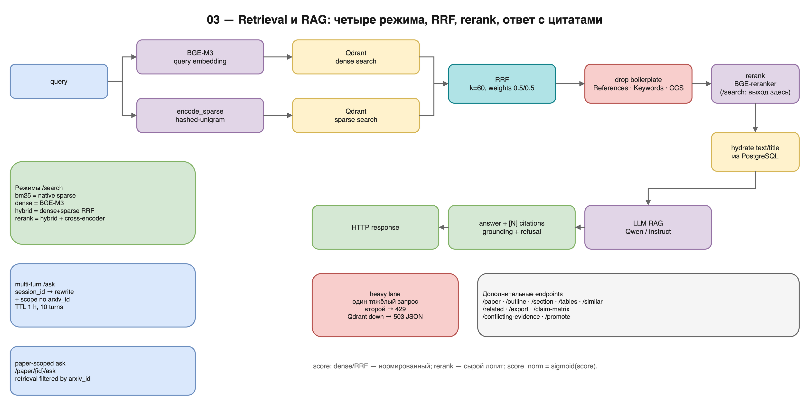

# 03 — Retrieval и RAG

> **Scope:** reference spec of the full deployment; this repository implements
> the core subset. See `README.md` in this directory and `../LIMITATIONS.md`.

**Цель части:** по индексам из [02](02-ingestion-and-indexing.md) собрать
поиск, rerank и генерацию ответов с цитатами, а также HTTP-контракт API.

**На выходе:**

- 4 режима `/search`: `bm25` (native sparse), `dense`, `hybrid`, `rerank`;
- `/ask` — RAG-ответ с inline-цитатами `[N]` и grounding;
- карточка статьи, оглавление, поиск по статье, похожие/связанные статьи,
  claim-matrix, conflicting-evidence, export, таблицы;
- предсказуемые ошибки и защита тяжёлых запросов.

**Предпосылки:** PG + Qdrant заполнены; endpoint'ы BGE-M3 и LLM доступны;
payload-индекс `arxiv_id` создан.

---

## 1. Поток запроса

### 1.1. `/search` (retrieval-only)

```
query
  ├─ dense:  BGE-M3(query) → Qdrant "dense" top-N
  ├─ sparse: encode_sparse(query) → Qdrant "sparse" top-N
  ├─ RRF (k=60, 0.5/0.5)
  ├─ [rerank] cross-encoder(query, top-N) → top-k
  └─ hydrate text/title из PG → response
```

### 1.2. `/ask` (RAG)

```
query
  ├─ [multi-turn] rewrite + optional scope по arxiv_id
  ├─ dense + sparse → RRF → drop boilerplate → rerank
  ├─ [min_score] отсечь хвост
  ├─ [dedupe_by_paper]
  ├─ hydrate text/title из PG
  ├─ [tables] подмешать строки таблиц из top-3 статей
  ├─ LLM: system prompt + [N]-пассажи
  └─ parse [N] → citations + grounding
```



*Схема 03 — поток запроса, режимы `/search`, RAG и дополнительные
эндпоинты. Исходник: `diagrams/03-retrieval-rag.drawio`.*

---

## 2. Dense retrieval

1. Эмбеддинг запроса тем же BGE-M3, что и при ингесте.
2. L2-нормализация на клиенте.
3. Qdrant `query_points` по named vector `dense`.
4. `search_params.quantization.rescore=true` — пересчёт top-K по fp32
   оригиналам на диске.
5. `with_payload=true`, `with_vectors=false`.

Результат — `RetrievalHit`:

```python
@dataclass
class RetrievalHit:
    chunk_id: str
    score: float            # 0..1 для dense/sparse/hybrid; logit для rerank
    source: str             # dense|sparse|hybrid|reranked|similar
    text: str
    arxiv_id: str
    heading_path: str
    title: str
    chunk_index: int
    year: int | None
    categories: list[str]
    raw_score: float | None
    tier: str               # fulltext|abstract
```

`text` после retrieval может быть пустым — его обязательно гидрировать из
PG (см. §6).

---

## 3. Sparse retrieval

- Тот же `encode_sparse(query)`, что и при ингесте (см. 02 §7).
- Qdrant `query_points` с `SparseVector(indices, values)`, `using="sparse"`.
- Score — dot product `log(1+TF)`; он неограничен. Для отображения можно
  нормировать на максимум страницы (на RRF это не влияет — RRF использует
  только ранги).
- Если в запросе нет токенов после stopwords — вернуть пустой список, а не
  падать.

**Терминологическая ловушка:** режим называется `bm25`, но в reference-системе
это **не Lucene BM25**, а hashed-unigram sparse. Историческое имя сохранено
для совместимости API. Если подключаешь настоящий BM25, честно переименуй
режим или опиши разницу в docs.

---

## 4. Hybrid и RRF

Reference-формула:

```
score(d) = Σ_i w_i / (k + rank_i(d))
k = 60
weights = (0.5, 0.5)   # dense, sparse
rank_i — 1-based
```

Кандидаты:

- `/search`: каждый retriever отдаёт `min(top_k_hybrid × 3, 500)`;
  fuse → top-`fetch_k`; для rerank — drop boilerplate и cap до
  `top_k_hybrid`.
- `/ask`: окно `_RETRIEVAL_WINDOW = 100`; каждый retriever отдаёт
  `min(100 × 3, 500)`; fuse → drop boilerplate → 100 → rerank top_k.

Overfetch нужен потому, что boilerplate-чанки (References, Keywords, CCS)
могут занимать почти весь top-50, и после их удаления reranker остаётся без
кандидатов.

---

## 5. Boilerplate: drop и demote

Boilerplate — секции, бесполезные для содержательного поиска:
`references`, `bibliography`, `acknowledgements`, `keywords`, `ccs concepts`
и т.п.

Две стратегии:

- **drop** — перед rerank/для hybrid: убрать boilerplate из кандидатов;
- **demote** — для `bm25`/`dense` без rerank: отсортировать так, чтобы
  содержательные чанки шли раньше, а boilerplate — в конце (не терять
  выдачу полностью).

Не применяй drop к `/paper/{id}/section?type=references`, если такой
эндпоинт нужен: там boilerplate — цель запроса.

---

## 6. Гидратация текста и title из PG

Qdrant payload не содержит `text` (payload-trim). После retrieval:

```sql
SELECT c.chunk_id::text, c.text, p.title
FROM chunks c
JOIN papers p ON p.arxiv_id = c.arxiv_id
WHERE c.chunk_id = ANY($1::uuid[]);
```

Один батч-запрос на ответ. Важно:

- сравнивай `chunk_id` как `uuid[]`, а не `::text = ANY(...)`: приведение
  колонки к text ломает использование PK и превращает запрос в скан
  миллионов строк;
- text из PG — авторитетный; Qdrant-payload может быть старым;
- заодно дозаполняй пустой `title` из `papers.title`;
- вычищай C0/C1 control-символы на этом же choke point.

---

## 7. Rerank

Reference-модель: `BAAI/bge-reranker-large` (cross-encoder).

- `max_length=512`;
- `dtype=bf16` на GPU (fp32 — fallback; fp16 — риск overflow);
- батч 16;
- `candidate_window=2000` символов на кандидата в `/search` и `/ask`
  (reference; короткое окно теряет контекст math-heavy чанков);
- модель грузится один раз и держится warm в API-процессе;
- HTTP-режим: llama-server `--reranking`; **шкала логитов другая** —
  `min_score` надо перекалибровать (reference: −4,0 для bge-reranker-large
  соответствует примерно −1,47 для bge-reranker-v2-m3).

Reranker не опционален для `/ask`: reference-замеры показали, что без него
качество заметно хуже. Для `/search` режим `hybrid` оставлен как быстрый и
иногда лучший для exploratory-запросов.

### 7.1. Веса и шкалы

- `score` в `rerank` — **сырой логит** cross-encoder, не 0..1 и не сравним
  между запросами.
- `raw_score` — сигнал до rerank (cosine/RRF).
- `score_norm = sigmoid(score)` — переносимая шкала 0..1 (reference API
  отдаёт её для reranked-хитов).
- `min_score` фильтрует по сырому логиту и **не переносим между запросами**.
  Для клиентского порога используй `score_norm` (например, ≥0,2).

---

## 8. Режимы и когда их использовать

| Режим | Что делает | Когда |
|---|---|---|
| `bm25` | sparse-only | точные термины, редкие слова, быстрый baseline |
| `dense` | embedding-only | семантическое сходство, парафразы |
| `hybrid` | dense + sparse → RRF | exploratory, «что такое X», обзоры |
| `rerank` | hybrid + cross-encoder | фактический/сравнительный поиск; дефолт |

Reference-наблюдения (датированы; перепроверяй на своём корпусе):

- rerank улучшает overall recall@10: hybrid 0,64 → rerank 0,73;
- на exploratory-запросах reranker (обученный на MS-MARCO, не на arXiv)
  может **ухудшать**: hybrid 0,67 → rerank 0,53;
- hashed-unigram sparse на 5k-подмножестве: nDCG 0,700 против 0,343 у
  OpenSearch BM25;
- rerank vs hybrid на 10k: nDCG@10 0,635 против 0,518.

Вывод: не делай `rerank` единственным режимом; оставь `hybrid` для
исследовательских запросов и дай клиенту выбор.

### 8.1. Tier в выдаче

Каждый hit несёт `tier="fulltext"|"abstract"`. Reference-система **не
делает автоматического буста** full-text: abstract-only статьи честно
участвуют в ранжировании. Риски:

- abstract-хиты могут доминировать на фактических запросах;
- ответ `/ask` по abstract-чанку короче и менее точен.

Что делать:

- измеряй долю abstract в top-10 и качество ответов по tier;
- при необходимости добавь явный rerank-буст full-text (это изменение
  ранжирования, его надо оценить, а не включать «на глаз»);
- для важной abstract-статьи — `POST /promote/{id}`.

Promotion всегда явный. Не делай скрытый автомат «при попадании в top-N
повысить статью» без измерения стоимости и предсказуемости.

---

## 9. Фильтры и recency

Поддерживаются три формы значений:

```jsonc
{"year": 2024}                                  // scalar
{"categories": ["cs.LG", "cs.CL"]}              // list
{"year": {"$gte": 2022, "$lte": 2024}}          // range
```

Алиасы:

- `category` → `categories`;
- `year`, `arxiv_id` — как есть.

`recency`:

- `last_12m`, `last_36m`, `all` — пресет поверх `year`.

Валидируй фильтры **до** запроса в Qdrant. Неизвестный оператор, пустой
список/диапазон, неверный тип → HTTP 400 с понятным сообщением, не 500.

Перед эксплуатацией фильтров проверь payload-индексы (`arxiv_id`, при
необходимости `year`, `categories`).

---

## 10. RAG-генерация

### 10.1. Модель и контракт

Reference: Qwen3.5-4B через OpenAI-compatible
`POST /v1/chat/completions`.

- `temperature` ~0,3 (reference);
- `max_tokens` ограничен (reference 200–512 в зависимости от эндпоинта);
- **thinking mode выключен** (`enable_thinking=false` либо серверным
  флагом, либо per-request `chat_template_kwargs`). Иначе `<think>` съедает
  весь бюджет и ответы обрываются;
- таймаут клиента — с запасом под CPU-serving (reference до 300 с на
  медленной плате).

### 10.2. Prompt

System prompt (сокращённо):

> Ты исследовательский ассистент. Используй **только** информацию из
> переданных пассажей. Если информации недостаточно — скажи это явно, не
> выдумывай. Будь краток: 2–3 предложения. Цитируй каждое утверждение
> inline номером пассажа `[N]` сразу после утверждения, например
> `RAG снижает галлюцинации на 30–50% [1]` или `[2, 4]`. Не собирай
> цитаты в конце.

Контекст собирается так:

```
[1] <первые 400 символов чанка>
[2] ...
```

- до 16 чанков в контексте (reference `context_max_chunks=16`);
- 400 символов на чанк — компромисс между покрытием и бюджетом токенов;
- если в контекст подмешаны строки таблиц, добавляется nudge: сравнивать
  числа из таблиц и явно указывать, если проза и таблица расходятся.

### 10.3. Цитаты

После генерации:

1. найти все `[N]` / `[N, M]`;
2. сопоставить с пассажами контекста;
3. отдать `citations[]`: `index`, `chunk_id`, `arxiv_id`, `quote` (~60
   символов), `section` (`heading_path`), `abs_url`, `pdf_url`;
4. для таблиц — `source="table"`, `page`, `table_index`, `verify_url`.

Если модель сослалась на несуществующий индекс — пропустить, не падать.

### 10.4. Empty retrieval и refusal

- Нет пассажей после фильтров → **200 OK** с честным refusal-текстом и
  пустым `context`, а не 500.
- Ошибка генерации → 200 с текстом ошибки и заполненным `context`
  (ретривер отработал); клиент видит, что именно сломалось.
- Модель может отказаться сама, если пассажи не отвечают на вопрос. Это
  нормальный сценарий, не баг.

### 10.5. Grounding

Reference-эвристика (без дополнительного LLM):

- `context_strength` = среднее `sigmoid(rerank logit)` по top-3
  цитированным пассажам (или top-3 вообще, если цитат нет);
- `confidence` = high/medium/low/refusal по порогам (reference 0,7 / 0,4);
- `warnings`: нет цитат, мало цитат относительно контекста, citation
  ratio и т.п.

Это **некалиброванная** эвристика: она полезна как индикатор «уверенно-
неверно», но не является вероятностью. Не выдавай её за гарантию.

---

## 11. Multi-turn

`POST /ask` с `session_id`:

1. если сессия есть — LLM переписывает follow-up в самодостаточный запрос
   (разрешает «these/those/the first one»);
2. опционально scope: retrieval ограничивается `arxiv_id` из прошлых ходов
   (до 20);
3. ответ содержит `session_id` (всегда), `rewritten_query`, `scoped`.

Ограничения reference:

- сессии **в памяти** процесса: TTL 1 час, cap 10 ходов;
- рестарт API = потеря сессий;
- клиент обязан эхоить `session_id` из ответа; литеральная строка не
  становится ключом.

Если multi-turn не нужен — не реализуй; stateless `/ask` самодостаточен.

---

## 12. Дополнительные эндпоинты

Reference API (детали полей — `docs/API.md`):

| Endpoint | Назначение | Тяжёлый? |
|---|---|---|
| `GET /health` | liveness + PG/Qdrant/embedder/reranker | нет |
| `GET /stats` | counts по кэшу, фоновый refresh | нет |
| `POST /search` | 4 режима | `rerank` — да |
| `POST /ask` | RAG | да |
| `GET /paper/{id}` | метаданные + chunk_ids + `tier`/`can_promote` | нет |
| `GET /paper/{id}/outline` | секции → chunk_ids | нет |
| `GET /paper/{id}/section?type=` | method/results/limitations/introduction | нет |
| `POST /paper/{id}/ask` | RAG только по одной статье | да |
| `GET /paper/{id}/tables` | извлечение таблиц, кэш в PG | да (первый раз) |
| `GET /paper/{id}/page/{n}/render` | PNG страницы для проверки | средне |
| `GET /similar/{id}` | dense-похожие чанки | нет |
| `GET /related/{id}` | граф цитирования | нет |
| `POST /export` | BibTeX/RIS | нет |
| `POST /claim-matrix` | method/dataset/metric/value из top-K статей | да |
| `POST /conflicting-evidence` | supports/refutes/neutral | да |
| `POST /promote/{id}` | очередь abstract→fulltext | нет |
| `GET /promote/{id}` | статус промоушена | нет |
| `GET/DELETE /session/{id}` | история/сброс | нет |

### 12.1. Paper-scoped ask

`POST /paper/{arxiv_id}/ask` = тот же RAG, но retrieval фильтруется по
`arxiv_id`. Это самая полезная функция для «нашёл статью — быстро понять
метод/результаты». 404, если у статьи нет чанков.

### 12.2. Claim matrix

Для запроса:

1. hybrid+rerank top-50;
2. группировка по статьям;
3. для top-K статей LLM извлекает `(method, dataset, metric, value)` из
   top-M чанков;
4. плоский `claims[]` + best-effort `matrix{metric: [...]}`.

Пустая матрица — часто не баг: retrieval принёс введение/related work без
конкретных чисел. Формулируй запрос вокруг бенчмарка («BLEU on WMT»,
«GLUE BERT scores»).

### 12.3. Conflicting evidence

Для yes/no вопроса: retrieval → LLM классифицирует stance каждого чанка
(`supports|refutes|neutral`) → группирует. Полезно для «литература
расколота». Не заставляй модель быть «нейтральной по умолчанию»: rubric
должен требовать commit к направлению доказательства, иначе всё станет
neutral.

### 12.4. Граф цитирования

`citations(src, dst, prefixed)` строится из refs-чанков (см. 05).
`GET /related/{id}` смешивает:

- `shared_refs` — bibliographic coupling;
- `co_cited` — co-citation;
- `cites_seed` — forward;
- `cited_by_seed` — backward.

Blended score (reference): `shared×2 + co_cited + 5×forward + 2×backward`.
Ортогонален dense `/similar`. Покрытие ограничено: только in-corpus рёбра.
В первом замере (корпус ~188k) хотя бы одного соседа имели ~45% статей;
после расширения графа покрытие выросло, но его надо перемерять на своём
корпусе.

---

## 13. Защита и ошибки

### 13.1. Heavy lane

Тяжёлые эндпоинты (`/ask`, `/paper/ask`, `/search rerank`,
`/claim-matrix`, `/conflicting-evidence`) защищены
семафором на 1:

- второй одновременный запрос получает **429** с JSON-причиной (<1 с,
  без очереди);
- перед `/ask` — preflight PG/Qdrant: недоступен store → **503** с JSON,
  не пустое тело;
- PG-only эндпоинты при этом продолжают работать.

Это не «красивость»: два параллельных `/ask` на 32 ГБ RAM вытесняют
Qdrant в swap и роняют оба запроса.

### 13.2. Коды ошибок

| Код | Когда |
|---|---|
| 200 | успех; сюда же пустая выдача и ошибка генерации (с текстом) |
| 400 | плохие фильтры/recency |
| 404 | статьи/сессии/чанков нет |
| 409 | конфликт состояния (например, promote не abstract) |
| 422 | схема запроса: пустой query, top_k вне границ, неизвестный mode |
| 429 | тяжёлый уже выполняется |
| 503 | PG/Qdrant недоступны (preflight) |
| 500 | внутренняя ошибка; тело — plain text, смотри логи |

JSON-логи: `ts`, `level`, `stage`, `msg`, payload. Не логируй тексты
запросов целиком, если это приватно; логируй длины/хеши.

---

## 14. Латентность

Reference-бюджеты (warm, без конкуренции):

**GPU-хост:**

| Режим | p50 | p95 |
|---|---|---|
| bm25 | 12 мс | 25 мс |
| dense | 27 мс | 40 мс |
| hybrid | 32 мс | 50 мс |
| rerank | 142 мс | 155 мс |
| `/ask` | ~750 мс | ~1,8 с |

**ARM-плата (тот же код, llama.cpp):**

| Запрос | Reference |
|---|---|
| `/search hybrid` | 0,7–2,2 с |
| `/search rerank` | 65–75 с |
| `/ask` | 197–243 с |
| `/paper/ask` | 113–117 с |
| `/claim-matrix` | 62–69 с |
| `/similar` | 1,7–3,1 с |
| `/related` | 0,8–0,9 с |

Разница в 100–300 раз — это цена CPU-serving. Если нужен интерактивный
ассистент, serving должен быть на GPU; ARM-плата годится как «витрина» с
последовательными тяжёлыми запросами.

---

## 15. Минимальная реализация (L1)

Если не нужны все эндпоинты:

1. `/health`
2. `/search` с `hybrid` и `rerank`
3. `/ask`
4. `/paper/{id}`
5. `/stats`

Этого достаточно, чтобы проверить архитектуру. Остальные эндпоинты —
аддитивные надстройки; их отсутствие не ломает основной сценарий.

---

## 16. Проверки

1. `/search` в 4 режимах возвращает 200 и непустые hits на осмысленных
   запросах.
2. `/search` с фильтром по `year`/`categories`/`arxiv_id` не таймаутит.
3. `rerank` не хуже `hybrid` на фактических запросах; на exploratory —
   проверь отдельно.
4. `/ask` даёт ответ с ≥1 цитатой; цитата указывает на статью, где факт
   есть.
5. Пустая выдача → refusal 200, не 500.
6. Второй одновременный тяжёлый запрос → 429.
7. При остановленном Qdrant `/search` → 503 JSON, `/paper` (PG-only) жив.
8. `/paper/{id}/ask` не выходит за пределы статьи.
9. `/related` на статье с известными связями (например, классической
   работе) даёт осмысленных соседей; на нишевой может быть пусто — это
   известное ограничение, не баг.
10. `score_norm` монотонен по `score`; `min_score` не применяется к
    `bm25`/`dense`/`hybrid`.

---

## 17. Типичные ошибки

| Ошибка | Симптом | Лечение |
|---|---|---|
| `bm25` считают настоящим BM25 | не совпадает с ожиданиями | это sparse hashed-unigram; переименуй/опиши |
| Rerank на всех запросах | exploratory-выдача хуже | дать `hybrid` как выбор |
| `min_score` фиксированный | на одних запросах режет всё, на других ничего | фильтровать `score_norm` клиентом |
| `candidate_window` слишком мал | теряется math-контекст | 2000 символов для `/ask`/`/search` |
| Не гидрируют text из PG | пустые hit.text после payload-trim | батч-запрос по `chunk_id` |
| Сравнение `chunk_id::text` | скан 20 млн строк, +секунды | `= ANY($1::uuid[])` |
| Нет boilerplate drop | References доминируют top-50 | drop перед rerank, demote без него |
| Фильтр без payload-индекса | таймаут 60 с | создать индекс |
| Два тяжёлых одновременно | swap/OOM, оба падают | heavy-lane 429 |
| Доверять grounding как вероятности | «уверенно-неверно» | эвристика некалибрована; проверять цитаты |

---

## 18. Что дальше

API готов → [04 — serving и эксплуатация](04-serving-and-operations.md):
железо, запуск, память, дампы. Метрики и приёмка —
[05 — оценка качества](05-evaluation-and-quality.md).
