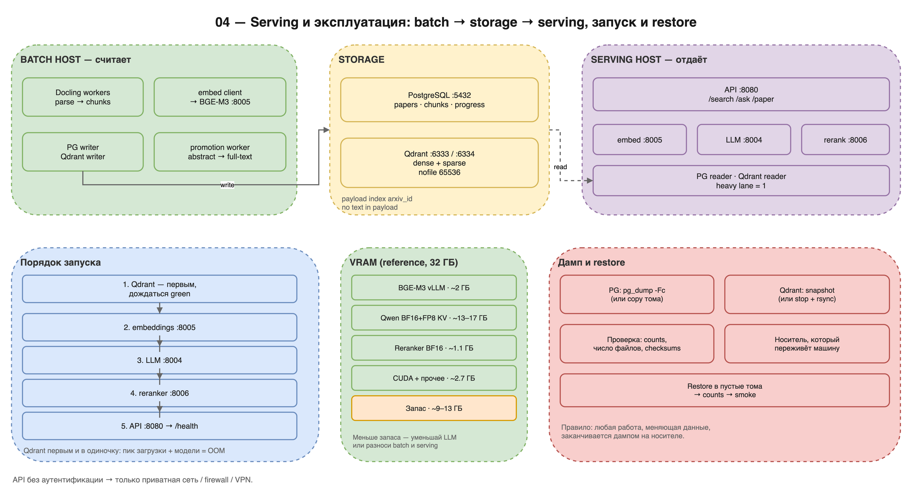

# 04 — Serving и эксплуатация

> **Scope:** reference spec of the full deployment; this repository implements
> the core subset. See `README.md` in this directory and `../LIMITATIONS.md`.

**Цель части:** развернуть систему так, чтобы она не падала от памяти,
переживала перезагрузку, обновлялась без потери данных и восстанавливалась
из дампа.

**На выходе:**

- запускаемый по шагам стек: PostgreSQL + Qdrant + эмбеддер + LLM +
  reranker + API;
- health-check и smoke;
- бюджет VRAM/RAM/диска;
- скрипты/процедуры дампа и restore;
- runbook на типовые инциденты.

**Предпосылки:** индексы собраны ([02](02-ingestion-and-indexing.md)),
API реализован ([03](03-retrieval-and-rag.md)).

---

## 1. Принцип разделения

> **Прод не считает — прод принимает.**

Batch-хост (GPU, много RAM) делает parse/embed/ingest. Serving-хост
(сколько угодно слабый) читает PG+Qdrant и отдаёт API. Batch пишет в
serving-хранилище по сети (или в общий том), но не делит с ним память.

На L1 допустимо совместить всё на одной машине. Тогда:

- не запускай ингест одновременно с тяжёлыми запросами;
- оставляй запас RAM/VRAM;
- после ингеста делай дамп, а не «оставь как есть».

Reference-развёртывание: batch-GPU + отдельная ARM-плата для serving.
Плата — витрина; GPU — кухня.

---

## 2. Профили железа

| Профиль | Batch | Serving | Комментарий |
|---|---|---|---|
| **L1 — одна машина** | 16–24 ГБ VRAM или CPU | та же машина | проще всего; следи за RAM |
| **L2 — GPU + слабый serving** | 24–32 ГБ VRAM, 64–128 ГБ RAM | 16–32 ГБ RAM | API на CPU-LLM будет медленным |
| **L3 — reference** | 32 ГБ VRAM, 125 ГБ RAM, NVMe | 32 ГБ RAM (ARM или x86) | batch и serving разделены |

Диск:

- PDF-архив — самый большой компонент (сотни ГБ — ТБ);
- PG — десятки ГБ;
- Qdrant — десятки–сотни ГБ;
- дампы — ещё столько же;
- модели — единицы–десятки ГБ.

Не ставь Qdrant и Docling на один 32-ГБ хост без расчёта: пик загрузки
коллекции + воркеры = OOM.

---

## 3. Топология и порты



*Схема 04 — топология, порядок запуска, бюджет VRAM и контур дампа/restore.
Исходник: `diagrams/04-serving-ops.drawio`.*

Порты reference (можно менять, но зафиксируй в конфиге):

| Сервис | Порт |
|---|---|
| PostgreSQL | 5432 |
| Qdrant HTTP / gRPC | 6333 / 6334 |
| LLM (OpenAI-compatible) | 8004 |
| Embeddings (OpenAI-compatible) | 8005 |
| Reranker (HTTP, опционально) | 8006 |
| API | 8080 |

Один порт — один владелец. Не запускай второй процесс на занятом порту:
юнит будет циклически падать с bind-error, а порт останется у «дубля».

---

## 4. Бюджет VRAM (reference, 32 ГБ)

| Компонент | VRAM |
|---|---|
| BGE-M3 vLLM | ~2 ГБ (`--gpu-memory-utilization 0.15`) |
| Qwen3.5-4B BF16 + FP8 KV | ~13–17 ГБ (`0.55`) |
| BGE-reranker-large BF16 | ~1,1 ГБ |
| CUDA context + прочее | ~2,7 ГБ |
| **Итого** | **~19–23 ГБ** |
| **Запас** | **~9–13 ГБ** |

Запас нужен для:
- пиков rerank/префилла;
- Docling, если он всё-таки на GPU;
- фрагментации памяти.

Если запас <5 ГБ — уменьшай LLM/квантование или разноси batch и serving.

На ARM-плате VRAM нет; всё в RAM. Модели квантуются (GGUF IQ4_NL и т.п.),
LLM обслуживается llama.cpp. Бюджет RAM: Qdrant + модели + API + swap.
Reference-плата: 32 ГБ RAM, 32 ГБ swap; Qdrant загружается пиково ~22 ГБ,
поэтому **сначала Qdrant, потом модели**.

---

## 5. Порядок запуска

### 5.1. Storage

Минимальный compose-файл (пароль и имя БД — из env, не из репозитория):

```yaml
services:
  postgres:
    image: postgres:16
    restart: unless-stopped
    environment:
      POSTGRES_DB: ${POSTGRES_DB}
      POSTGRES_USER: ${POSTGRES_USER}
      POSTGRES_PASSWORD: ${POSTGRES_PASSWORD}
    ports: ["5432:5432"]
    volumes: ["pgdata:/var/lib/postgresql/data"]
    healthcheck:
      test: ["CMD-SHELL", "pg_isready -U $${POSTGRES_USER} -d $${POSTGRES_DB}"]
      interval: 10s

  qdrant:
    image: qdrant/qdrant:v1.12.4
    restart: unless-stopped
    ports: ["6333:6333", "6334:6334"]
    ulimits:
      nofile: {soft: 65536, hard: 65536}
    volumes: ["qdrantdata:/qdrant/storage"]

volumes:
  pgdata:
  qdrantdata:
```

Запуск:

```bash
export POSTGRES_DB=<db> POSTGRES_USER=<user> POSTGRES_PASSWORD=<secret>
docker compose -f docker-compose.storage.yml up -d
```

На некоторых ARM-дистрибутивах `docker compose plugin` отсутствует.
Тогда либо установи plugin, либо подними те же два контейнера через
`docker run` с теми же портами/томами/ulimit. Не используй
`--remove-orphans` на живой системе: он может снести чужие контейнеры.

Проверка:

```bash
pg_isready -h <PG_HOST> -p 5432 -U <PG_USER>
curl -fsS <QDRANT_URL>/collections/<COLLECTION> | \
  python3 -c 'import json,sys; d=json.load(sys.stdin)["result"]; print(d["status"], d["points_count"])'
```

Ожидается `green` (или `yellow` на пустой коллекции). Если `grey` —
проверь `optimizer_status` и CPU; в некоторых версиях Qdrant `grey` — это
«ещё оптимизируется», а не ошибка.

### 5.2. Модели

Порядок reference:

1. **Qdrant** — первым и в одиночку, дождаться загрузки/зелёного статуса.
2. **Embeddings** (8005).
3. **LLM** (8004).
4. **Reranker** (8006, если HTTP-режим).
5. **API** (8080) — последним.

На GPU-хосте можно поднять эмбеддер и LLM параллельно, если VRAM хватает;
на ARM — строго последовательно, иначе OOM.

Примеры команд (reference-схема; подставь свои модели и пути):

```bash
# BGE-M3, OpenAI-compatible embeddings на :8005
vllm serve BAAI/bge-m3 \
  --host 0.0.0.0 --port 8005 \
  --gpu-memory-utilization 0.15 \
  --max-model-len 8192 --trust-remote-code

# LLM, OpenAI-compatible chat на :8004
vllm serve <LLM_MODEL> \
  --host 0.0.0.0 --port 8004 \
  --gpu-memory-utilization 0.55 \
  --max-model-len 8192 \
  --kv-cache-dtype fp8_e5m2 \
  --default-chat-template-kwargs '{"enable_thinking":false}' \
  --trust-remote-code
```

Для llama.cpp (CPU/ARM):

```bash
# embeddings
llama-server -m <BGE_M3_GGUF> --embedding \
  --host 0.0.0.0 --port 8005 \
  -c 4096 -b 4096 -ub 4096

# reranker (HTTP-режим)
llama-server -m <RERANKER_GGUF> --reranking \
  --host 0.0.0.0 --port 8006 \
  -b 4096 -ub 4096

# LLM
llama-server -m <LLM_GGUF> \
  --host 0.0.0.0 --port 8004 \
  -t 4 -c 8192 -b 4096 -ub 4096
```

⚠ На ARM-плате не поднимай `-b/-ub` выше 4096: это раздувает RSS и
кладёт плату. Клиентские таймауты к эмбеддеру должны быть **не меньше**
времени обработки сервером, иначе после разрыва сервер продолжает считать
«фантомные» задачи.

`503` от llama-server сразу после старта — норма: модель ещё грузится.
Не считай это ошибкой, дай 30–120 с.

### 5.3. API

```ini
[Unit]
Description=arxiv-search API
After=network-online.target
Wants=network-online.target

[Service]
Type=simple
WorkingDirectory=<PROJECT_ROOT>
Environment=PYTHONPATH=src
Environment=PG_DSN=<PG_DSN>
Environment=QDRANT_URL=<QDRANT_URL>
Environment=QDRANT_COLLECTION=<COLLECTION>
Environment=BGE_M3_ENDPOINT=<EMBED_URL>
Environment=BGE_M3_MODEL=<EMBED_MODEL>
Environment=LLM_URL=<LLM_URL>
Environment=LLM_MODEL=<LLM_MODEL>
Environment=LLM_TIMEOUT_S=300
# 127.0.0.1 is the safe default; use a private interface only behind a
# firewall/VPN, never a public 0.0.0.0 without authentication.
ExecStart=<VENV>/bin/python -m uvicorn arxiv_mvp.api.app:app \
  --host 127.0.0.1 --port 8080
Restart=on-failure
RestartSec=5
StandardOutput=journal
StandardError=journal
MemoryMax=32G
LimitMEMLOCK=infinity

[Install]
WantedBy=default.target
```

**Важно:** пример юнита предполагает, что приложение читает эти env. Если
твой код берёт адреса из жёстких дефолтов, добавь явное чтение env и
логируй резолвленные значения при старте. Иначе получишь «молчаливый
дефолт»: сервис жив, а запросы уходят не туда.

Установка (user-level systemd):

```bash
mkdir -p ~/.config/systemd/user
# сохрани пример юнита выше как ~/.config/systemd/user/arxiv-api.service
$EDITOR ~/.config/systemd/user/arxiv-api.service
systemctl --user daemon-reload
systemctl --user enable --now arxiv-api
journalctl --user -u arxiv-api -f
```

Если systemd недоступен — запускай uvicorn под процесс-супервизором
(supervisor, s6, runit). Главное: автоперезапуск и логи.

### 5.4. Health и smoke

```bash
curl -fsS <API_HOST>/health
curl -fsS -X POST <API_HOST>/search \
  -H 'Content-Type: application/json' \
  -d '{"query":"retrieval augmented generation","mode":"hybrid","top_k":5}'
```

`/health` должен показать `postgres: ok`, `qdrant: ok`, `embedder: ok`,
`reranker_loaded: true`. Если Qdrant ещё грузится, API может стартовать,
но поисковые эндпоинты будут отдавать 503 — это лучше, чем crash-loop.

---

## 6. Qdrant: настройки, без которых больно

1. **`nofile: 65536`.** Docker default 1024 исчерпывается за минуты
   sustained upsert; после этого каждый upsert падает с
   `Too many open files`. Это не «медленно», это массовые отказы.
2. **Payload-trim.** Не храни `text` в payload; текст в PG. Иначе Qdrant
   ест примерно вдвое больше RAM/диска.
3. **Payload-индексы для фильтров.** Как минимум `arxiv_id` (keyword).
   Фильтр по неиндексированному полю = скан всех точек = таймаут.
4. **`always_ram`.** INT8-векторы в RAM; fp32-оригиналы на диске.
   Попытка `PATCH always_ram:false` на некоторых версиях оставляет
   коллекцию в `grey` навсегда; не делай это без проверки на копии.
5. **CPU budget** на слабом хосте. Оптимизатор может занять все ядра и
   «повесить» плату по SSH. Ограничь число CPU для Qdrant.
6. **Порядок старта.** Сначала Qdrant, дождаться загрузки, потом модели и
   API. Иначе Qdrant выдавлен OOM и уходит в restart-loop.

---

## 7. Память и защита от OOM

### 7.1. правило одного тяжёлого запроса

Тяжёлые эндпоинты (`/ask`, `/paper/ask`, `/search rerank`,
`/claim-matrix`, `/conflicting-evidence`) должны выполняться
**по одному**. Reference реализует это серверным семафором:

- второй одновременный → HTTP 429 с JSON-причиной;
- без очереди (очередь = ещё больше памяти).

Не полагайся на дисциплину клиента.

### 7.2. Preflight хранилищ

Перед `/ask` проверь PG и Qdrant:

- недоступны → 503 JSON с причиной;
- не отдавай пустой 200/500 без объяснения.

### 7.3. Swap

На 32-ГБ RAM хосте с Qdrant:
- swap 16–32 ГБ на быстром диске;
- swap помогает пережить пик, но после шторма страницы могут не
  вернуться — «новая норма» до restart;
- если swap занят >80% — не запускай тяжёлые запросы, дай системе
  успокоиться.

### 7.4. Batch vs serving

Не запускай Docling/ингест на serving-хосте при живом API. Если иначе
нельзя:
- останови API и Qdrant-нагрузку;
- сделай бэкап;
- прогони ингест;
- перезапусти serving и проверь `/health`.

---

## 8. Наблюдаемость

Логи — JSON lines в stdout/journal. Минимальные поля:

```json
{"ts":"...","level":"info","stage":"search","msg":"request_done",
 "mode":"hybrid","top_k":10,"elapsed_ms":31.7}
```

Для ингеста логируй:

- `done`, `failed`, `remaining`, `rate`, `eta`;
- `mean_parse_s`, `mean_embed_s`, `mean_write_s` — без них нельзя понять,
  где узкое место;
- endpoint/collection/limits при старте (резолвленные значения).

Метрики:

- `/stats` — из кэша, фоновая ревалидация (не считай counts в request-path
  на 20 млн чанков);
- `/health` — дешёвый;
- счётчики 429/503, средние латентности по режимам.

Алерты (минимум):

- API down >2 мин;
- Qdrant не green >10 мин;
- swap >80%;
- ingestion rate = 0 при non-empty worklist;
- 5xx rate >1%.

---

## 9. Дамп и restore

### 9.1. Что считается дампом

- **PG:** `pg_dump -Fc` (custom format) базы.
- **Qdrant:** snapshot коллекции или консистентная копия тома при
  остановленном Qdrant.
- **Конфиги:** политика, манифесты прогонов, `.env.example`, версии.
- **Метаданные/PDF:** по желанию; их можно перекачать, но это долго.
- **История:** runbook, решения, известные грабли.

Правило reference: **любая работа, меняющая данные, заканчивается дампом на
носителе, который переживёт машину.** Дамп, оставшийся только на рабочем
NVMe, дампом не считается.

### 9.2. PG dump/restore

```bash
# dump
pg_dump -h <PG_HOST> -U <PG_USER> -d <PG_DB> -Fc \
  -f <BACKUP_DIR>/arxiv_$(date +%F).dump

# restore в пустую базу
createdb -h <PG_HOST> -U <PG_USER> <PG_DB>
pg_restore -h <PG_HOST> -U <PG_USER> -d <PG_DB> \
  --no-owner --no-privileges <BACKUP_DIR>/arxiv_$(date +%F).dump
```

Проверка после restore:

```sql
SELECT count(*) FROM papers;
SELECT count(*) FROM chunks;
SELECT count(*) FROM citations;
```

Counts должны совпасть с дампом.

### 9.3. Qdrant snapshot

```bash
# создать snapshot
curl -X POST <QDRANT_URL>/collections/<COLLECTION>/snapshots

# список и скачивание
curl -fsS <QDRANT_URL>/collections/<COLLECTION>/snapshots
curl -fsS -o <BACKUP_DIR>/<COLLECTION>.snapshot \
  <QDRANT_URL>/collections/<COLLECTION>/snapshots/<snapshot_name>
```

Restore:

```bash
curl -X POST "<QDRANT_URL>/collections/<COLLECTION>/snapshots/upload?priority=snapshot" \
  -F 'snapshot=@<BACKUP_DIR>/<COLLECTION>.snapshot'
```

Проверка:

```bash
curl -fsS <QDRANT_URL>/collections/<COLLECTION> | \
  python3 -c 'import json,sys; d=json.load(sys.stdin)["result"]; print(d["status"], d["points_count"])'
```

### 9.4. Копия томов (reference-проверенный путь)

Если snapshot API недоступен или коллекция огромна:

1. Останови Qdrant и PG (без `--remove-orphans`, если это compose).
2. Скопируй тома `rsync -a --info=progress2`.
3. Зафиксируй **число файлов** и размер (маркеры целостности).
4. Запусти контейнеры, проверь counts.
5. Для переносного HDD: батчи с паузами, `hdparm -B 254 -S 0`,
   USB2-порт, `fsck` после аварийного отключения; монтирование по UUID.

Reference-маркеры (276k статей): PG ~25 ГБ / ~1,4 тыс. файлов; Qdrant
~155 ГБ / ~8,9 тыс. файлов. Число файлов — быстрый способ поймать
недокопированный том.

### 9.5. Restore-порядок

1. Пустые тома/базы.
2. PG restore → проверка counts.
3. Qdrant restore/копия → дождаться green → проверка points.
4. Запуск моделей.
5. Запуск API.
6. Smoke: `/health`, `/search`, `/ask`.
7. Сверка counts с дампом: `papers`, `chunks`, Qdrant points. Для свежего
   корпуса дополнительно `Qdrant points = PG chunks`; для долгоживущего —
   те же исторические counts, что были до дампа (разрыв PG↔Qdrant может
   быть унаследован и не является ошибкой restore).

Reference-время restore на USB2: 1,5–2 ч для 180 ГБ. На NVMe — минуты.

---

## 10. Runbook

### 10.1. После перезагрузки

1. `swapon --show` — swap есть.
2. Storage (PG/Qdrant) → wait healthy/green.
3. Модели по одной: embed → rerank → LLM.
4. API.
5. `/health`, `/search hybrid`, один `/ask`.
6. Если что-то не так — сначала `uptime`, `free -m`, `dmesg | grep -i oom`,
   потом логи приложения.

### 10.2. Обновление кода

1. Зафиксируй текущие counts/версии.
2. Сделай дамп (PG + Qdrant snapshot), если меняешь схему/данные.
3. Обнови код в канонической копии.
4. Прогони миграции схемы (идемпотентные `CREATE TABLE IF NOT EXISTS` /
   `ALTER`).
5. Перезапусти API.
6. Smoke: `/health`, `/search`, `/ask`.
7. Если регресс — откат кода + restore дампа.

### 10.3. Добавление корпуса

1. Собери дельту и проверь её против PG ([01](01-data-and-corpus.md)).
2. Скачай PDF.
3. Прогони smoke на 50–100 статьях.
4. Полный ингест волнами.
5. Проверки: counts, partition, self-retrieval, deltas.
6. Дамп на носитель.

### 10.4. Деградация: дерево диагностики

```
Медленно / ошибки
├─ uptime: load > CPU count?
│  └─ да → тяжёлый запрос/индексация; подождать, не запускать второй
├─ free -m: swap > 80%?
│  └─ да → пост-штормовое состояние; перезапуск Qdrant/API, дать осесть
├─ dmesg | grep -i oom
│  └─ Qdrant killed → поднимать Qdrant первым, уменьшить конкурентность
├─ Qdrant status grey/optimizer
│  └─ ждать/ограничить CPU; не делать PATCH always_ram
├─ фильтрованный запрос ровно 60 с → нет payload-индекса
├─ SSE/HTTP 503 → модель грузится или store недоступен (preflight)
└─ 429 → heavy-lane занят; это защита, а не баг
```

### 10.5. Откат

- Код: предыдущий commit/архив; рестарт.
- Схема: миграции должны быть аддитивными; откат — restore дампа.
- Модель: вернуть прежний id/endpoint, перезапустить.
- Индекс: если менял чанкер/эмбеддер — нужна переиндексация, не
  «переключение флага».

---

## 11. Безопасность

Reference API **без аутентификации**. Это осознанно для приватной
лабораторной сети.

Минимум:

- слушай API на приватном интерфейсе (`--host` не `0.0.0.0`, если не
  нужен LAN-доступ);
- firewall: разрешай только доверенную подсеть;
- не публикуй порты PG/Qdrant в интернет;
- секреты — в env/секрет-менеджере, не в git;
- регулярно обновляй образы PG/Qdrant/моделей;
- ограничь `max_tokens`/`top_k`, чтобы один клиент не съел RAM.

Если нужен публичный доступ — поставь reverse proxy с аутентификацией,
rate limit и TLS. Это **вне** reference-реализации; не делай вид, что
«API сам защитится».

---

## 12. Стоимость и время (reference-ориентиры)

| Операция | Время/ресурс |
|---|---|
| Полный ингест 330k статей | несколько суток batch-GPU |
| Инкремент 25–30k статей | ~1 день (PDF + full-text subset + abstract) |
| Qdrant snapshot 155 ГБ | десятки минут–часы (зависит от диска) |
| PG dump 25 ГБ | минуты |
| Restore 180 ГБ через USB2 | 1,5–2 ч |
| Холодный старт API | секунды–минуты (импорты + загрузка моделей) |
| Warm `/search hybrid` (GPU) | десятки мс |
| Warm `/ask` (GPU) | ~0,75 с p50 |

---

## 13. Known failure modes

| Симптом | Причина | Лечение |
|---|---|---|
| Qdrant RestartCount растёт, load 50+ | OOM при загрузке коллекции + модели | Qdrant первым, swap, меньше моделей, payload-trim |
| `Too many open files` | Docker `nofile=1024` | `ulimit nofile=65536` |
| API crash-loop | Qdrant/PG недоступны на старте | try/except вокруг init, 503 вместо падения |
| Второй `/ask` убивает первый | RAM-пик | heavy-lane 1 |
| Фильтр ровно 60 с | нет payload-индекса | создать индекс |
| Пустые `hit.text` | payload-trim без гидратации | читать text из PG |
| Эмбеддинги идут на мёртвый хост | endpoint прочитан на импорте | резолв в конструкторе |
| Docling завис | сеть/IPv6/HF-проверка | offline-HF, SIGALRM |
| PDF качается 0,3 МБ/с | битый IPv6 | force IPv4 |
| Модель грузится, а API уже отвечает 500 | нет preflight/503 | проверять health моделей |
| `grey` навсегда после PATCH | несовместимость конфига и сегментов | реверт к `always_ram:true`, не PATCH-ить |
| Дамп не восстанавливается | копия без counts/checksums | файловые маркеры + `pg_restore --list` |

---

## 14. Приёмочный чек-лист эксплуатации

- [ ] Storage стартует после ребута, Qdrant green.
- [ ] Модели стартуют в правильном порядке, 503→200.
- [ ] API стартует автоматически, `/health` зелёный.
- [ ] `/search` и `/ask` проходят smoke.
- [ ] Второй тяжёлый запрос → 429.
- [ ] При остановленном Qdrant `/search` → 503 JSON, `/paper` жив.
- [ ] Swap/load/OOM видны в мониторинге.
- [ ] Дамп PG + Qdrant создаётся по расписанию.
- [ ] Restore проверен в пустые тома; counts совпали.
- [ ] Секреты не в git; API не в публичном интернете.
- [ ] Runbook обновлён после инцидента.

---

## 15. Что дальше

Эксплуатация без оценки качества — это вера. Переходи к
[05 — оценка качества](05-evaluation-and-quality.md): gold set, метрики,
приёмочные проверки ингеста и граф цитирования.
