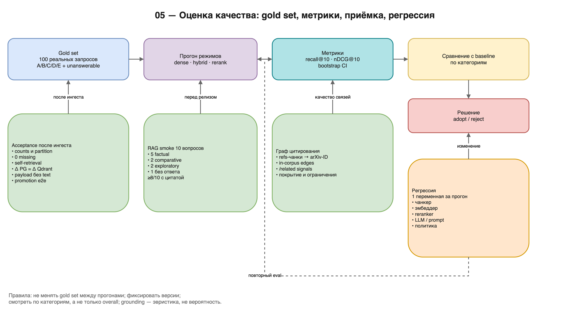

# 05 — Оценка качества

> **Scope:** reference spec of the full deployment; this repository implements
> the core subset. See `README.md` in this directory and `../LIMITATIONS.md`.

**Цель части:** доказать числами, что retrieval и RAG работают, что ингест
не потерял статьи, а изменения моделей/чанкера/политики не ухудшили выдачу.

**На выходе:**

- замороженный gold set реальных запросов;
- отчёт по retrieval (recall@10 / nDCG@10 по режимам и категориям);
- отчёт по генерации (ответы, цитаты, grounding, отказы);
- acceptance-проверки после каждого ингеста;
- метрики графа цитирования и ограничения `/related`;
- процесс регрессии при изменениях.

**Предпосылки:** индексы собраны; API работает; есть 2–3 часа на разметку
небольшого eval-набора.



*Схема 05 — контур оценки и приёмочные гейты. Исходник:
`diagrams/05-evaluation.drawio`.*

---

## 1. Принципы

1. **Оценивай реальные запросы.** Синтетические вопросы, сгенерированные
   моделью из случайных чанков, оптимизируют не тот objective. В reference
   такой набор (366 Q/A) был признан невалидным и заменён.
2. **Один эксперимент — одна переменная.** Сравнивай режимы на одном
   корпусе, одном gold set, одной версии чанкера.
3. **Фиксируй всё.** Версии модели, чанкера, политики, корпуса, дату.
4. **Разделяй retrieval и generation.** Плохой ответ может быть следствием
   плохого retrieval, а не LLM.
5. **Смотри на категории запросов.** Средняя метрика скрывает провалы:
   rerank может улучшать overall и ухудшать exploratory.
6. **Не подгоняй порог под eval.** `min_score` и `score_norm` — разные
   вещи; фиксированный логит-порог не переносим между запросами.
7. **Отчёт без CI — мнение.** Для маленьких наборов считай bootstrap
   confidence interval.

---

## 2. Gold set

### 2.1. Состав

Reference-подход — ~100 реальных запросов, написанных под исследовательские
сценарии, с размеченными релевантными чанками/статьями.

Категории:

| Категория | Пример | Что проверяет |
|---|---|---|
| A — factual | «Какая функция потерь у VAE?» | точный факт |
| B — method | «Как работает reparameterization trick?» | метод |
| C — comparative | «Чем BERT отличается от RoBERTa?» | сравнение |
| D — metrics | «BLEU BERT на WMT» | числа/бенчмарки |
| E — exploratory | «обзор retrieval-augmented generation» | обзор/фундаментальные работы |

### 2.2. Как собрать

1. Возьми 50–200 статей, покрывающих разные годы и категории.
2. Для каждой сформулируй 1–2 вопроса, на которые ответ **есть в тексте**.
3. Найди в статье чанк(и), где ответ действительно содержится; запиши
   `arxiv_id` + `chunk_id` (или хотя бы `arxiv_id`).
4. Добавь 10–20 exploratory-запросов без единственного gold-чанка:
   оценивай по статьям/классу работ, а не по одному фрагменту.
5. Заморозь файл; не меняй его при каждом эксперименте.
6. Для сравнения моделей добавь 10–20 вопросов, где ответа в корпусе нет
   (проверка refusal/галлюцинаций).

Минимальный формат:

```jsonl
{"qid":"A001","query":"...","category":"A_factual",
 "gold_chunk_ids":["..."],"gold_arxiv_ids":["..."],
 "notes":"ответ в разделе 3.2"}
```

### 2.3. Чего избегать

- вопросов, ответ на которые неоднозначен;
- вопросов, требующих внешних знаний, которых нет в корпусе (если это не
  тест на refusal);
- «вопросов из abstract без проверки», что ответ есть в тексте;
- изменения gold set между сравниваемыми прогонами.

---

## 3. Retrieval-метрики

### 3.1. Основные

- **Recall@10** — доля запросов, где хотя бы один gold-чанк попал в top-10.
- **nDCG@10** — качество ранжирования с бинарной или graded релевантностью.
- **MRR@10** — обратный ранг первого релевантного (удобно для factual).
- **Hit@1** — доля запросов с релевантным на первом месте.

Для comparative/metrics полезно считать `recall@50` — ответ может быть
размазан по нескольким статьям.

### 3.2. Как считать

Для каждого запроса:

1. получить top-K `chunk_id`/`arxiv_id` в данном режиме;
2. сопоставить с gold;
3. агрегировать по категориям и overall;
4. посчитать bootstrap 95% CI (ресемплинг запросов).

Не сравнивай `score` между режимами: у dense — cosine, у hybrid — RRF,
у rerank — логит. Сравнивай **порядок** и метрики ранжирования.

### 3.3. Reference-результаты (датированы; не переноси без перепроверки)

Первый baseline (10k, nDCG@10):

| Режим | nDCG@10 |
|---|---|
| BM25 (OpenSearch, исторический) | 0,230 |
| dense | 0,534 |
| hybrid | 0,518 |
| rerank | **0,635** |

Sparse-замена (5k): hashed-unigram nDCG 0,700 против OpenSearch BM25 0,343.

100 реальных запросов (recall@10):

| Режим | Overall | Exploratory |
|---|---|---|
| hybrid | 0,64 | 0,67 |
| rerank | **0,73** | 0,53 |

Прирост rerank по категориям: D_metrics +0,30, C_comparative +0,10,
B_method +0,08, A_factual +0,05.

**Главный вывод:** rerank — хороший default для фактических/сравнительных
запросов, но **не универсален**. Для exploratory оставь `hybrid`.

### 3.4. Что ещё проверять

- **Boilerplate:** доля References/Keywords в top-10 до и после drop/demote.
  Reference наблюдал до 46/50 boilerplate на survey-запросах.
- **Tier:** доля abstract-only в top-10. Если abstract-слой доминирует на
  factual-запросах, это сигнал: нужен буст full-text или promotion.
- **Latency:** p50/p95 по режимам; отдельно retrieval и rerank.
- **Фильтры:** запросы с `year`/`categories` не должны таймаутить и не
  должны терять релевантные статьи.

---

## 4. Оценка генерации (RAG)

### 4.1. Что измерять

| Метрика | Как |
|---|---|
| Answer correctness | ручная/LLM-judge оценка по gold-ответу |
| Citation correctness | каждая `[N]` указывает на пассаж, поддерживающий утверждение |
| Citation coverage | доля утверждений с цитатой |
| Grounding | эвристика `context_strength` + warnings |
| Refusal correctness | на вопросах без ответа — отказ, а не галлюцинация |
| Latency | p50/p95 |

Reference-подход: LLM-judge для масштаба + ручная проверка подвыборки.
Judge должен получать вопрос, ответ и gold-контекст; не показывай ему
название модели/режима.

### 4.2. Smoke на 10 вопросов

Минимум перед релизом:

1. 5 вопросов с проверяемыми фактами (числа, названия методов);
2. 2 comparative;
3. 2 exploratory;
4. 1 вопрос без ответа в корпусе.

Критерии:

- ≥8/10 не refusal и содержат ≥1 цитату;
- для 5 фактов цитата указывает на статью, где факт есть (ручная проверка);
- вопрос без ответа → refusal или честное «в пассажах нет»;
- нет 500;
- latency в бюджете.

### 4.3. Grounding — что это и чем не является

`context_strength` = среднее `sigmoid(rerank logit)` по цитируемым
пассажам. Это **эвристика**, не вероятность и не калиброванный confidence.
Она полезна, чтобы поймать «уверенно-неверно» (высокий confidence на
слабом контексте), но не гарантирует истину.

Не используй grounding как единственный критерий качества. Всегда проверяй
цитаты.

### 4.4. Multi-turn

Проверь:

- follow-up с «these/those/the first one» переписывается в
  самодостаточный запрос;
- scope не выходит за статьи прошлых ходов;
- `session_id` эхоится, история доступна, TTL/лимит работают;
- после рестарта API сессия теряется (ожидаемо).

---

## 5. Acceptance после ингеста

Эти проверки обязательны после каждого батча, независимо от eval.

### 5.1. Counts

```sql
SELECT count(*) AS papers FROM papers;
SELECT count(*) AS chunks FROM chunks;
SELECT count(*) AS done FROM ingestion_progress
WHERE status = 'done';
```

Qdrant:

```bash
curl -fsS <QDRANT_URL>/collections/<COLLECTION> | \
  python3 -c 'import json,sys; d=json.load(sys.stdin)["result"]; print(d["points_count"])'
```

Гейт: для свежего корпуса `Qdrant points = PG chunks` (минус
залогированные zero-norm). Для инкремента — `Δ Qdrant = Δ PG`; накопленный
исторический разрыв (в reference ~55 тыс. точек) веди отдельным отчётом и
не смешивай с потерей текущего батча.

### 5.2. Partition

```sql
-- abstract-only
WITH one AS (
  SELECT arxiv_id FROM chunks GROUP BY arxiv_id
  HAVING count(*) = 1 AND min(heading_path) = 'Abstract'
)
SELECT
  (SELECT count(*) FROM papers) AS papers,
  (SELECT count(*) FROM one) AS abstract_only,
  (SELECT count(DISTINCT arxiv_id) FROM chunks) AS with_chunks;
```

Гейт: `papers = with_chunks`, `abstract_only + fulltext = papers`,
пересечение пусто.

### 5.3. Нет missing

```sql
SELECT count(*) FROM papers p
WHERE NOT EXISTS (SELECT 1 FROM chunks c WHERE c.arxiv_id = p.arxiv_id);
```

Гейт: 0 для целевого батча.

### 5.4. Self-retrieval

Возьми 10–20 статей; запроси точную фразу из title/abstract; проверь, что
статья в top-10. Reference-пример: abstract-only статья находилась на
rank 1/100 по своему заголовку.

### 5.5. PG↔Qdrant дельта

После батча:

```text
Δ PG chunks == Δ Qdrant points
```

Reference: +652 928 = +652 928. Расхождение дельты — сигнал потери точек
(батчинг, таймаут, repair). Абсолютные counts PG и Qdrant в долгоживущем
корпусе могут расходиться из-за истории; это фиксируется отдельно.

### 5.6. Payload

- `text` отсутствует в payload;
- `tier` присутствует у abstract;
- `arxiv_id` и `chunk_id` заполнены;
- фильтр по `arxiv_id` не таймаутит.

### 5.7. Promotion

См. 02 §11.3: abstract → queued → full-text → abstract-чанк удалён.

---

## 6. Граф цитирования

### 6.1. Построение

Reference не требует отдельного парсинга PDF: refs-секции уже есть в чанках.

1. Взять чанки с `heading_path ~* '(references|bibliography|works cited)'`.
2. Извлечь arXiv-ID регулярками:
   - современный `YYMM.NNNNN`;
   - старый `archive/YYMMNNN`;
   - опциональный префикс `arXiv:`.
3. Валидировать `YYMM` (год 2007–2026, месяц 1–12).
4. Исключить self-citations.
5. Оставить только ID, присутствующие в корпусе.
6. Записать `citations(src, dst, prefixed)` с PK `(src, dst)`.
7. Fallback: для статей без refs-заголовка проверить хвост документа.

```sql
CREATE TABLE IF NOT EXISTS citations (
    src TEXT NOT NULL,
    dst TEXT NOT NULL,
    prefixed BOOLEAN NOT NULL DEFAULT FALSE,
    PRIMARY KEY (src, dst)
);
CREATE INDEX IF NOT EXISTS idx_citations_dst ON citations(dst);
```

### 6.2. Reference-результат

| Метрика | Значение |
|---|---|
| Рёбер (2026-08-24, корпус ~276k) | **1 335 411** |
| Цитирующих статей | **174 107** |
| Первый замер (2026-06-28, корпус ~188k) | 159 239 рёбер; 71 541 citing; 46 456 cited; out-degree avg/max 2,23 / 511 |
| Покрытие (статья имеет ≥1 соседа) | ~45% в первом замере; перемеряй на текущем корпусе |

Граф растёт вместе с корпусом и повторным майнингом; не переноси старые
counts как текущие.

### 6.3. `/related`

Сигналы:

- `shared_refs` — bibliographic coupling;
- `co_cited` — co-citation;
- `cites_seed` — forward (T цитирует seed);
- `cited_by_seed` — backward (seed цитирует T).

Blended score reference: `shared×2 + co_cited + 5×forward + 2×backward`.

### 6.4. Ограничения

- Граф **in-corpus only**: статьи вне CS/STAT-корпуса не разрешаются, поэтому
  у нишевых работ рёбер мало или нет.
- Coverage в первом замере ~45%; для части статей `/related` пуст — это не
  баг. После расширения корпуса и повторного майнинга покрытие меняется;
  измеряй его на своём графе.
- На landmarks (Attention, VAE, Qwen) качество отличное; на разреженных
  подполях — шумно.
- Граф ортогонален dense `/similar`; не заменяй одно другим.
- Для роста покрытия нужен рост корпуса или внешний citation API
  (reference-проект его не использует).

---

## 7. Процесс регрессии

Изменение, требующее eval:

- чанкер (размер, заголовки, таблицы, overlap);
- эмбеддер (модель/версия/нормализация);
- sparse-энкодер;
- reranker (модель/dtype/окно);
- LLM (модель/промпт/бюджет);
- политика отбора корпуса;
- фильтры/boilerplate;
- схема payload.

Порядок:

1. Зафиксируй baseline: версии, counts, eval-метрики, латентности.
2. Измени **одну** переменную.
3. Прогони тот же gold set.
4. Посчитай метрики + CI; разбей по категориям.
5. Проверь smoke (10 вопросов) и acceptance (§5).
6. Запиши решение: adopt/reject, причина, дата.
7. Для больших изменений — A/B на одном и том же корпусе, без
   одновременной смены модели и индекса.

### 7.1. Шаблон отчёта

```markdown
# Eval <date> — <change>

- Corpus: <papers/chunks>, snapshot <date>
- Chunker: <version>, target_tokens=<n>
- Embedder: <model>, dim=<n>
- Reranker: <model>, dtype=<...>, window=<n>
- LLM: <model>, prompt=<version>
- Gold set: <n queries>, categories <...>
- Index: <collection>, points=<n>

| Mode | recall@10 | nDCG@10 | p50 ms | p95 ms |
|---|---|---|---|---|
| dense | | | | |
| hybrid | | | | |
| rerank | | | | |

## By category
...

## Generation
- answered: <n>/<n>
- cited: <n>/<n>
- citation correct (manual sample): <n>/<n>
- refusals on unanswerable: <n>/<n>
- grounding warnings: <...>

## Decision
<adopt/reject + why>
```

---

## 8. Известные качественные ограничения

| Ограничение | Проявление | Что делать |
|---|---|---|
| rerank ухудшает exploratory | обзоры теряют фундаментальные работы | `hybrid` для exploratory |
| boilerplate | References/Keywords в top-10 | drop перед rerank, demote без |
| abstract-only слабее full-text | ответы по abstract менее точные | `tier` в выдаче, promotion, eval |
| comparative/metrics | ответ размазан, LLM отказывается | `recall@50`, несколько статей в контексте |
| niche `/related` | пусто/шумно | не считать регрессом; dense `/similar` |
| grounding некалиброван | «уверенно-неверно» | проверять цитаты |
| citation graph in-corpus | ~55% статей без соседей в первом замере | рост корпуса/внешний API |
| table extraction дорогая | первый парс минуты на CPU | кэш в PG, отдельный эндпоинт |
| `min_score` не переносим | на разных запросах разный эффект | `score_norm` на клиенте |
| синтетический eval | метрики не отражают реальные запросы | реальные gold-запросы |

---

## 9. Smoke-скрипты (reference-набор)

Полезно иметь:

- `smoke_storage` — PG/Qdrant доступны;
- `smoke_retrieval` — 4 режима на 3 запросах;
- `smoke_ask_api` — `/health` + `/ask` + цитаты;
- `smoke_reranker` — загрузка и один rerank;
- `verify_dump_topic` — counts в дампе;
- `repair_qdrant_paper` — восстановление точек статьи;
- `eval_retrieval` — recall/nDCG по gold set;
- `eval_rag_judge` — judge/grounding.

Скрипты должны быть идемпотентны и не менять данные, кроме явно
разрешённых операций (repair, promote).

---

## 10. Типичные ошибки

| Ошибка | Симптом | Лечение |
|---|---|---|
| Синтетические вопросы | высокие метрики, плохой UX | реальные gold-запросы |
| Менять gold set между прогонами | несравнимые результаты | заморозить |
| Менять несколько переменных | непонятно, что помогло | одна переменная |
| Смотреть только overall | пропущен провал exploratory | разбивка по категориям |
| Считать `score` между режимами | бессмысленные сравнения | метрики ранжирования |
| Нет CI на 20 запросах | шум принят за эффект | bootstrap CI |
| Игнорировать пустую выдачу | «ну нет ответа» | различать refusal и баг retrieval |
| Не проверять цитаты | красиво, но неверно | ручная выборка |
| Не делать acceptance после ингеста | тихая потеря статей | §5 |
| Верить grounding | галлюцинация с high confidence | цитаты + ручная проверка |

---

## 11. Итог

Система считается воспроизведённой, когда:

- ингест проходит acceptance §5 без missing;
- retrieval-метрики зафиксированы и не хуже выбранного baseline;
- RAG smoke §4.2 проходит;
- граф цитирования построен (если нужен `/related`);
- дамп создан и restore проверен;
- отчёт содержит версии, числа, даты и решение.

Дальше — только эксплуатация и инкрементальные обновления по
[01](01-data-and-corpus.md) / [04](04-serving-and-operations.md).
