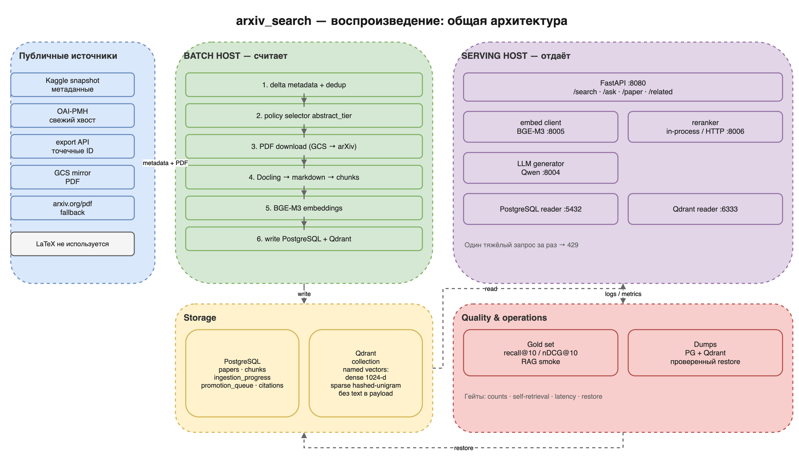

# arxiv_search — спецификация воспроизведения с нуля

> **Scope note (this repository).** This directory is the reference
> specification of the complete private deployment. The code in this
> repository implements the core subset: hybrid retrieval, rerank, RAG, and
> the abstract-only/full-text ingest paths. Features listed in the spec as
> extras (paper outline/section, tables, claim matrix, conflicting evidence,
> citation graph, promotion, multi-turn, SEO) are **not implemented here**.
> Use the spec to reproduce the measured reference system, not as a
> description of this repository's API surface. See `../LIMITATIONS.md`.

**Версия:** 1.0 · **Дата:** 2026-10-21
**Аудитория:** сторонний агент-разработчик в любом harness; человек-инженер,
которому нужен воспроизводимый рецепт, а не наш внутренний контекст.
**Статус:** reference-описание работающей системы; числа датированы и служат
ориентирами, а не жёсткими нормативами.

---

## 0. Как пользоваться этим документом

Это сводная спека. Она задаёт порядок работ и приёмочные гейты. Детали —
в пяти тематических документах:

| Документ | Тема |
|---|---|
| [01-data-and-corpus.md](01-data-and-corpus.md) | откуда брать статьи, как формировать корпус, политика отбора |
| [02-ingestion-and-indexing.md](02-ingestion-and-indexing.md) | PDF → Docling → чанки → эмбеддинги → PostgreSQL + Qdrant |
| [03-retrieval-and-rag.md](03-retrieval-and-rag.md) | dense/sparse/hybrid/rerank, RRF, генерация ответов с цитатами |
| [04-serving-and-operations.md](04-serving-and-operations.md) | железо, запуск, ресурсы, защита от OOM, дампы и restore |
| [05-evaluation-and-quality.md](05-evaluation-and-quality.md) | метрики, gold set, smoke/acceptance, граф цитирования |

**Правила для агента-исполнителя:**

1. Работай фазами (§5). Не начинай следующую фазу, пока гейт предыдущей не
   пройден **числом или командой**, а не «похоже, работает».
2. Все значения конфигурации (пути, endpoint'ы, лимиты) должны резолвиться
   и печататься в лог при старте. Молчаливый дефолт — баг.
3. Секреты — только через переменные окружения. В примерах ниже используются
   плейсхолдеры `<...>`; не подставляй в документацию реальные ключи и адреса.
4. Долгие операции (>30 минут) обязаны быть идемпотентными, возобновляемыми и
   логировать латентности стадий.
5. Не выдумывай результаты: если гейт не пройден, зафиксируй фактическое
   число и остановись.

---

## 1. Что это за система

Исследовательский ассистент поверх корпуса arXiv CS/STAT. Система:

- хранит метаданные статей и чанки текста в **PostgreSQL**;
- хранит dense- и sparse-векторы чанков в **Qdrant**;
- ищет в четырёх режимах: `bm25` (на самом деле native sparse), `dense`,
  `hybrid` (RRF), `rerank` (cross-encoder поверх hybrid);
- отвечает на вопросы через RAG: retrieval → rerank → LLM → ответ с
  inline-цитатами `[N]` и эвристикой grounding;
- умеет: карточку статьи, оглавление, поиск по одной статье, таблицы,
  сравнение claims, conflicting evidence, похожие/связанные статьи,
  multi-turn диалог;
- поддерживает двухуровневый корпус: **full-text** (PDF → чанки) и
  **abstract-only** (title+abstract одним чанком) с возможностью promotion.

### 1.1. Reference-масштаб (замер 2026-10-17)

| Метрика | Значение |
|---|---|
| Статей в PG | **328 769** |
| Чанков в PG | **20 212 035** |
| Точек в Qdrant | **20 156 803** |
| Abstract-only статей | **19 574** |
| Full-text статей (в дельте 2610) | **7 946** |
| Годы | **2007–2026** |
| Метаданные CS/STAT (накопительно) | ~1,07 млн записей |
| PDF-архив (не весь проиндексирован) | 596 134 файла / ~2,35 ТБ |
| PG (276k статей) | ~25 ГБ |
| Qdrant-том (276k статей) | ~155 ГБ |

Число чанков PG и точек Qdrant в reference-корпусе расходится на ~55 тыс.
из-за исторических прогонов; для нового батча проверяется равенство дельт
(см. 02 §14). Это **не обязательный** масштаб. Уровни воспроизведения — §4.

### 1.2. Стек

| Слой | Reference-выбор | Допустимая замена |
|---|---|---|
| Язык/API | Python 3, FastAPI + uvicorn | любой HTTP-стек, сохраняющий контракт |
| Метаданные/чанки | PostgreSQL 16 | PostgreSQL 15+ |
| Векторы | Qdrant 1.12.x, dense + native sparse | Qdrant другой версии с теми же API |
| PDF-парсер | Docling (markdown) | другой парсер, но чанки и качество изменятся |
| Embeddings | BAAI/bge-m3, 1024-d, cosine | другая модель → пересобрать весь индекс |
| Reranker | BAAI/bge-reranker-large (BF16) | любой cross-encoder/HTTP-reranker, перекалибровать `min_score` |
| Генератор | Qwen3.5-4B, OpenAI-compatible `/v1/chat/completions` | любая instruct-модель |
| Serving LLM | vLLM (GPU) или llama.cpp (CPU/ARM) | любой OpenAI-compatible сервер |
| Sparse | hashed-unigram, `log(1+TF)`, 2^18 бакетов | BM25-движок, но семантика `bm25`-моды изменится |

Версии пакетов фиксируй в lock-файле/образе. Версии моделей и парсера —
в манифесте каждого прогона.

---

## 2. Архитектура и поток данных



*Схема 00 — общая архитектура. Исходник: `diagrams/00-overview.drawio`.*

**Принцип reference-развёртывания:** batch-хост считает тяжёлое, serving-хост
только принимает и отдаёт. На L1 допустимо совместить их на одной машине, но
тогда ресурсы нужно делить явно и не запускать ингест одновременно с
тяжёлыми запросами.

### 2.1. Два уровня корпуса

- **Full-text:** PDF скачан → Docling → markdown → чанки ~300 токенов →
  эмбеддинги. В Qdrant payload `tier="fulltext"`.
- **Abstract-only:** один чанк `title + "\n\n" + abstract`,
  `heading_path="Abstract"`, `chunk_index=0`, `tier="abstract"`.
  PDF не скачивается.
- **Promotion:** abstract-only статья по запросу повышается до full-text:
  PDF скачивается, индексируется, synthetic abstract-чанк удаляется.

Инвариант: каждая статья корпуса имеет **либо** full-text чанки, **либо**
ровно один abstract-чанк. Пересечений нет.

---

## 3. Минимальный сквозной сценарий (L1)

Цель: за несколько часов получить работающий поиск и RAG на 1–5 тыс. статей.

1. Взять свежий публичный snapshot метаданных arXiv (Kaggle) или скачать
   ID через export API.
2. Отфильтровать CS/STAT, взять N статей, скачать PDF из публичного
   GCS-зеркала.
3. Поднять PostgreSQL и Qdrant (docker compose).
4. Создать коллекцию Qdrant с named vectors `dense` + `sparse`.
5. Прогнать пайплайн: parse → chunk → embed → write.
6. Поднять эмбеддер (BGE-M3) и LLM (любая instruct-модель с OpenAI API).
7. Запустить FastAPI; проверить `/health`, `/search`, `/ask`.
8. Прогнать smoke-набор и один eval-запрос с gold-ответом.

Детали каждого шага — в 01–04. Гейты — в §5.

---

## 4. Уровни воспроизведения

| | L1 — demo | L2 — production-like | L3 — reference |
|---|---|---|---|
| Статей | 1–5 тыс. | 50–300 тыс. | ~330 тыс. |
| Глубина | можно abstract-only | full-text + abstract tier | full-text + abstract tier |
| GPU | 16–24 ГБ или CPU | 24–32 ГБ | 32 ГБ batch + отдельный serving |
| RAM | 16–32 ГБ | 64–128 ГБ | 125 ГБ batch / 32 ГБ serving |
| Диск | 20–100 ГБ | 0,5–2 ТБ | 3–4 ТБ |
| Время ингеста | часы | 1–3 суток | несколько суток |
| Qdrant | локально | локально | отдельный хост/том |
| Reranker | опционален | обязателен | обязателен |
| Цель | проверить пайплайн | реальное использование | наш замеренный масштаб |

**Ресурсные ориентиры reference-замеров (2026-09/10):**

- ингест full-text: **1,5–1,9 статьи/с** при 6–10 Docling-воркерах;
- эмбеддинг BGE-M3 на GPU: **~495 чанков/с**;
- средние стадии на reference-прогоне: parse ~2,0 с, embed ~0,38 с,
  write ~4,3 с (запись через сетевой туннель — самая дорогая);
- 27,5 тыс. новых статей: ~0,2 ГБ abstract-слоя + ~25–31 ГБ PDF на
  full-text подмножество, ~1,5–2 ч full-text ингеста;
- serving на ARM-плате: `/search hybrid` 0,7–2,2 с, `/search rerank`
  65–75 с, `/ask` 197–243 с. На GPU serving на порядки быстрее; выбирай
  железо под latency-требование.

Не ориентируйся на «красивые» числа без замера: throughput зависит от PDF,
парсера, сети и диска. Замеряй стадии отдельно.

---

## 5. Порядок работ и гейты

### Фаза 0 — решение о масштабе и железе

Выход: выбран уровень L1/L2/L3, посчитаны RAM/VRAM/диск/сеть **числами**.

Гейт: таблица ресурсов заполнена; для batch-хоста свободно минимум
~9 ГБ VRAM и ~30 ГБ RAM сверх нужд ОС и соседних сервисов; для serving
хватает VRAM на выбранную LLM + эмбеддер + reranker.

### Фаза 1 — данные

Выход: метаданные в JSON/JSONL, список ID, PDF на диске.

Гейт:
```bash
# число записей и уникальных ID совпадает с ожидаемым
python3 - <<'PY'
import json
rows = json.load(open("<METADATA_JSON>"))
ids = [r["id"].strip() for r in rows]
print(len(rows), len(set(ids)))
assert len(rows) == len(set(ids))
PY
```
Плюс: для каждого скачанного PDF файл > 100 байт; число файлов совпадает с
числом ID, у которых есть PDF.

### Фаза 2 — storage

Выход: PostgreSQL и Qdrant запущены, коллекция создана.

Гейт:
```bash
psql "<PG_DSN>" -c "SELECT 1;"
curl -fsS "<QDRANT_URL>/collections/<COLLECTION>" | \
  python3 -c 'import json,sys; d=json.load(sys.stdin)["result"]; print(d["status"], d["points_count"])'
```
Ожидается `green` (или `yellow` на пустой коллекции) и `points_count=0`.

### Фаза 3 — smoke-ингест

Выход: 50–100 статей проиндексированы.

Гейт:
```bash
psql "<PG_DSN>" -c "SELECT count(*) FROM papers; SELECT count(*) FROM chunks;"
curl -fsS -X POST "<QDRANT_URL>/collections/<COLLECTION>/points/count" \
  -H 'Content-Type: application/json' -d '{"exact":true}'
```
Число точек Qdrant **равно** числу чанков PG (допустимы только явно
залогированные пропуски zero-norm). Self-retrieval: поиск по точной фразе из
заголовка статьи возвращает её в top-10. На долгоживущем корпусе проверяй
равенство **дельты батча**; исторические расхождения фиксируй отдельно.

### Фаза 4 — полный ингест корпуса

Выход: все выбранные статьи проиндексированы; нет «missing».

Гейт:
- `papers = fulltext + abstract-only` (partition без потерь);
- `Qdrant points = PG chunks` для свежего корпуса; для инкремента —
  `Δ Qdrant = Δ PG`, исторические расхождения учтены отдельно;
- `0` статей без чанков;
- все строки `ingestion_progress` со `status='done'` для целевого батча;
- повторный запуск не добавляет дублей.

### Фаза 5 — retrieval

Выход: API отдаёт `bm25`, `dense`, `hybrid`, `rerank`.

Гейт: на 20–50 запросах с известными релевантными статьями recall@10
`rerank` не ниже `hybrid`, а `hybrid` не ниже `dense`; для exploratory
запросов проверь, что rerank не ухудшает выдачу (известный эффект, см. 03).

### Фаза 6 — RAG

Выход: `/ask` возвращает ответ, `[N]`-цитаты и `grounding`.

Гейт: 10 вопросов с проверяемыми фактами; ≥8 ответов не являются refusal и
содержат хотя бы одну цитату, указывающую на статью, где факт действительно
есть (ручная проверка). Пустая выдача — не 500, а честный refusal.

### Фаза 7 — serving

Выход: `/health` зелёный, API доступен по сети, тяжёлые запросы защищены.

Гейт:
```bash
curl -fsS "<API_HOST>/health"
curl -fsS -X POST "<API_HOST>/search" \
  -H 'Content-Type: application/json' \
  -d '{"query":"retrieval augmented generation","mode":"hybrid","top_k":5}'
```
`/health` показывает PG/Qdrant/embedder ok; `/search` отвечает 200 и
содержит ≥1 hit с непустым `text`.

### Фаза 8 — приёмка и бэкап

Выход: eval-отчёт, дамп, restore-проверка.

Гейт: restore в пустые тома даёт те же counts; `/search` и `/ask` работают
после restore; документы и дампы лежат на носителе, который переживёт
переустановку машины.

---

## 6. Что обязательно совпадает для паритета

Если нужен **тот же** результат, а не «похожий ассистент»:

1. Текст чанков и правила чанкинга (заголовки, ~300 токенов, hard cap
   9000 символов, атомарные таблицы, без overlap) — иначе изменятся
   `content_hash` и выдача.
2. Модель эмбеддингов и её размерность; L2-нормализация; cosine.
3. Sparse-энкодер: regex, stopwords, `md5(tok)[:4]` → 2^18, `log(1+TF)`.
   Другой энкодер = другой индекс.
4. RRF: `k=60`, веса 0.5/0.5.
5. Поля payload Qdrant: `arxiv_id`, `chunk_id`, `chunk_index`,
   `heading_path`, `token_count`, `title`, `year`, `categories`, `tier`.
6. Контракт `SearchHit`/`AskResponse` (см. 03 и `docs/API.md`).

## 7. Что можно заменить

- LLM-генератор — на любую модель с OpenAI-compatible API; качество и
  латентность изменятся, контракт — нет.
- Reranker — на другой cross-encoder; **перекалибруй `min_score`**, потому
  что шкала логитов у моделей разная.
- Docling — на другой PDF→markdown парсер; ожидай изменения chunk count и
  качества. Прогони eval заново.
- PostgreSQL/Qdrant — на совместимые версии; схему и имена векторов сохрани.
- vLLM на GPU — на llama.cpp на CPU/ARM; производительность упадёт, API
  останется тем же.

## 8. Секреты и безопасность

- API в reference-реализации **не имеет аутентификации**. Не выставляй его
  в публичный интернет; слушай на приватном интерфейсе или закрывай
  firewall/VPN.
- Пароли БД, ключи API, SSH-ключи и адреса — в env/секрет-менеджере, не в
  git и не в этой документации.
- Все примеры используют плейсхолдеры `<PROJECT_ROOT>`, `<DATA_ROOT>`,
  `<PG_DSN>`, `<QDRANT_URL>`, `<EMBED_URL>`, `<LLM_URL>`, `<API_HOST>`.
- Публичные данные arXiv не содержат наших секретов; приватными являются
  только инфраструктурные параметры.

---

## 9. Приёмочный чек-лист

- [ ] Выбран уровень L1/L2/L3; ресурсы посчитаны.
- [ ] Метаданные скачаны и дедуплицированы; PDF идемпотентно скачаны.
- [ ] PG-схема создана; Qdrant-коллекция с `dense` + `sparse` создана.
- [ ] Smoke-ингест: `Qdrant points = PG chunks`.
- [ ] Полный ингест: partition без потерь, 0 missing.
- [ ] `/search` работает во всех четырёх режимах.
- [ ] `/ask` даёт ответ с цитатами; пустая выдача → refusal, не 500.
- [ ] `/paper`, `/paper/{id}/ask`, `/related`, `/similar` работают.
- [ ] Eval: recall@10/nDCG@10 зафиксированы; нет регресса относительно
      выбранного baseline.
- [ ] `/health` зелёный; тяжёлые запросы сериализованы; 429/503 с JSON.
- [ ] Дамп PG + Qdrant; restore проверен на пустых томах.
- [ ] В документации/конфигах нет приватных данных.

---

## 10. Карта документов

1. **[01 — данные и корпус](01-data-and-corpus.md)**: источники, загрузка,
   дедупликация, политика `abstract_tier`, манифесты.
2. **[02 — ингест и индексы](02-ingestion-and-indexing.md)**: парсинг,
   чанкинг, эмбеддинги, схемы PG/Qdrant, promotion.
3. **[03 — retrieval и RAG](03-retrieval-and-rag.md)**: моды поиска, RRF,
   rerank, генерация, API-контракт.
4. **[04 — serving и эксплуатация](04-serving-and-operations.md)**: железо,
   порядок запуска, ресурсы, дампы, runbook.
5. **[05 — оценка качества](05-evaluation-and-quality.md)**: gold set,
   метрики, smoke/acceptance, граф цитирования.

---

## 11. Вне scope

- Публикация корпуса, PDF, дампов и моделей.
- Поддержка произвольных ОС и one-click установка.
- Обучение моделей.
- Аутентификация и мультитенантность.
- Воспроизведение отвергнутых экспериментов (OpenSearch 3-store, SPLADE,
  overlap) — только как краткие decision records в 03/05.

---

## 12. Глоссарий

| Термин | Значение |
|---|---|
| **paper** | запись arXiv (`arxiv_id`), метаданные + связь с чанками |
| **chunk** | фрагмент текста статьи с `heading_path` и `chunk_index` |
| **tier** | `fulltext` или `abstract` — глубина индексации статьи |
| **promotion** | повышение abstract-only статьи до full-text по запросу |
| **dense** | вектор BGE-M3, 1024-d, cosine |
| **sparse** | hashed-unigram вектор `log(1+TF)` в Qdrant |
| **RRF** | Reciprocal Rank Fusion, `Σ w/(k+rank)`, k=60 |
| **rerank** | cross-encoder, переоценивающий top-N кандидатов |
| **RAG** | retrieval + генерация ответа по найденным пассажам |
| **grounding** | эвристика уверенности ответа по силе контекста и цитатам |
| **run / manifest** | иммутабельный прогон политики и его паспорт с хешами |
| **gate** | проверяемое условие перехода к следующей фазе |
